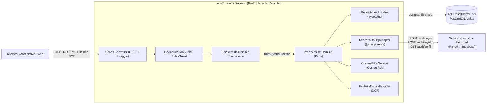

# AsisConexión Backend (MVP v2.0.0)

Backend **Monolito Modular en NestJS + TypeScript estricto** para **AsisConexión**, la puerta de entrada móvil (React Native) y Web de la **Fundación Asisco**.

Construido bajo metodología **Spec-Driven Development (SDD OpenAPI-First)** y gobernado por la Constitución del proyecto (`v2.0.0`): prohibición absoluta de `any`, principios **SOLID** estrictos con **Inversión de Dependencias (DIP)**, persistencia única PostgreSQL (`ASISCONEXION_DB`), integración HTTP con el servicio central de identidad en **Render / Supabase**, errores homologados **RFC 7807 (`application/problem+json`)**, paginación obligatoria para gama de entrada (**RT-01**), moderación en dos capas (**Filtro Automático + RN-02**) y trazabilidad de consentimiento conforme a la **Ley 1581 de 2012** y **Ley 1098 de 2006** (Colombia).

---

## 1. ¿Qué se implementó en el proyecto (v2.0.0)?

Se completó la implementación integral del backend MVP v2 organizada en **2 capas transversales** y **5 módulos de dominio independientes**:

1. **Infraestructura Transversal (`src/config/`, `src/common/`, `src/database/`)**:
   - **Validación tipada fail-fast** de variables de entorno (`env.validation.ts`).
   - **Persistencia Única PostgreSQL** (`DatabaseModule`): conexión de lectura/escritura sobre `ASISCONEXION_DB` (`default`), eliminando toda conexión directa a bases de datos externas.
   - **Autenticación por Sesión de Dispositivo con JWT** (`SessionAuthModule`, `SessionTokenService`, `DeviceSessionGuard`, `OptionalDeviceSessionGuard`, `RolesGuard`): emisión de tokens JWT únicos (`jti`) vinculados a `DeviceSession` en BD y validación de roles `ADMIN` (`external_roles`) y `MODERATOR` (`local_role`).
   - **Calidad y Seguridad**: filtro global RFC 7807 (`AllExceptionsFilter`), redacción recursiva de credenciales en logs (`redactSensitiveFields`), protección contra coerción booleana en consentimiento legal (`preserveRawConsentValue`) y paginación estándar `RT-01` (`PaginationQueryDto`, `PaginationMetaDto`).
   - **Migraciones y Semillas Idempotentes**: 5 migraciones SQL reversibles (`1761430000000`–`1761430400000`) y 3 seeders (`categories`, `redirection_links`, `faq_knowledge`).
2. **US1 & US2 — Identidad Híbrida, Sesiones, Perfil `Actor` y Conexiones (`AuthSessionModule`)**:
   - Login (`/v1/auth/login` y alias `/v1/auth/sync-session`) y registro (`/v1/auth/registro`) consumiendo el servicio HTTP de Render/Supabase (`https://proyecto-integrador-backend-g2.onrender.com`) mediante `IExternalAuthAdapter`, persistiendo transaccionalmente `UserAccount` (con `external_user_id` numérico, `external_roles` y sin `clave`), perfil `Actor` 1:1 y `DeviceSession` antes de firmar el `device_token`.
   - Sesiones rápidas anónimas por dispositivo (`/v1/sessions/anonymous`) con cuota diaria de publicación y sin perfil `Actor`.
   - Perfiles extendidos y red de conexiones (`Actor` y `ActorConnection`: `/v1/actors/me`, `/v1/actors/:id`, `/v1/connections`, `/v1/connections/:id`) exclusivos para usuarios registrados.
3. **US3 — Foros Comunitarios Públicos Enriquecidos (`SocialModule`)**:
   - Listado paginado de categorías públicas con tema principal e imagen de portada (`/v1/categories`) y muro público exclusivamente con publicaciones `APPROVED` (`/v1/posts`), incluyendo `media_urls`, resumen de reacciones y últimos 3 comentarios aprobados.
   - Creación de publicaciones con múltiples URLs multimedia (`PostMedia`), hilos de comentarios anidados (`parent_id`), y reacciones alternables (`LIKE`, `SUPPORT`, `THANKS`) tanto en publicaciones (`/v1/posts/:postId/reactions`) como en comentarios (`/v1/comments/:id/reactions`).
4. **US4 — Moderación en Dos Capas y Gestión de Moderadores (`ModerationModule`)**:
   - **Capa 1 (Filtro Automático OCP)**: `ContentFilterService` evalúa cada publicación y comentario mediante reglas `IContentRule` (`ProfanityContentRule`, `ExternalLinkContentRule`, `MinorDataContentRule`, `SpamContentRule`); si infringe alguna regla, se persiste inmediatamente con `status = 'REJECTED'` y `rejection_reason = 'AUTO_FILTER'`.
   - **Capa 2 (Moderación Humana RN-02)**: El contenido que supera el filtro automático nace en `status = 'PENDING'` y es revisado en `/v1/admin/moderation/*` por usuarios `ADMIN` o `MODERATOR` (`rejection_reason = 'HUMAN'`).
   - **Gestión de Moderadores Globales**: Los usuarios `ADMIN` pueden listar (`GET /v1/admin/moderators`), asignar (`PUT /v1/admin/moderators/:userAccountId`) y revocar (`DELETE /v1/admin/moderators/:userAccountId`) el rol global `MODERATOR`.
5. **US5 — Directorio de Módulos Satélites (`DirectoryModule`)**:
   - Catálogo paginado de enlaces activos (`SUMA 21`, `AULA UP`, `SAGA-UP`) con URLs HTTPS limpias para apertura nativa externa.
6. **US6 — Asistente Orientativo y Escalamiento a WhatsApp (`AssistantModule`)**:
   - Consulta de preguntas frecuentes filtrables por categoría (`/v1/assistant/faqs`) con *disclaimer* institucional obligatorio mediante `IAssistantEngineProvider` (`FaqRuleEngineProvider`) y generación de enlace directo a WhatsApp (`/v1/assistant/escalate`).

---

## 2. Arquitectura del Proyecto (v2.0.0)



---

## 3. Catálogo de Endpoints (`/v1`)

| Módulo | Método y Ruta | Auth | Descripción |
|---|---|---|---|
| `AuthSession` | `POST /v1/auth/registro` | Bearer opcional | Registra en Render/Supabase, sincroniza `UserAccount` + `Actor` y emite `device_token` |
| `AuthSession` | `POST /v1/auth/login` | Bearer opcional | Autentica en Render (`POST /auth/login`), sincroniza `UserAccount` + `Actor` y emite `device_token` |
| `AuthSession` | `POST /v1/auth/sync-session` | Bearer opcional | Alias de login sincronizado por compatibilidad |
| `AuthSession` | `POST /v1/sessions/anonymous` | Público | Crea sesión rápida de dispositivo con consentimiento Ley 1581 |
| `AuthSession` | `GET /v1/actors/me` | `Bearer JWT` (Registrado) | Obtiene perfil `Actor` del usuario autenticado |
| `AuthSession` | `PATCH /v1/actors/me` | `Bearer JWT` (Registrado) | Actualiza perfil `Actor` del usuario autenticado |
| `AuthSession` | `GET /v1/actors/:id` | Público | Consulta perfil público de un `Actor` por UUID |
| `AuthSession` | `GET /v1/connections` | `Bearer JWT` (Registrado) | Lista conexiones del `Actor` autenticado |
| `AuthSession` | `POST /v1/connections` | `Bearer JWT` (Registrado) | Envía solicitud de conexión (`PENDING`) a otro `Actor` |
| `AuthSession` | `PATCH /v1/connections/:id` | `Bearer JWT` (Registrado) | Acepta (`ACCEPTED`) o bloquea (`BLOCKED`) una conexión |
| `Social` | `GET /v1/categories` | Público | Lista categorías públicas paginadas (`RT-01`) |
| `Social` | `GET /v1/posts` | Público | Lista únicamente publicaciones `APPROVED` con `media_urls`, reacciones y comentarios |
| `Social` | `POST /v1/posts` | `Bearer JWT` | Crea publicación evaluando `ContentFilterService` (`PENDING` o `REJECTED` por `AUTO_FILTER`) |
| `Social` | `POST /v1/posts/:postId/comments` | `Bearer JWT` | Crea comentario (con soporte `parent_id`) evaluando `ContentFilterService` |
| `Social` | `POST /v1/posts/:postId/reactions` | `Bearer JWT` | Alterna (`toggle`) reacción `LIKE`, `SUPPORT` o `THANKS` en publicación |
| `Social` | `POST /v1/comments/:id/reactions` | `Bearer JWT` | Alterna (`toggle`) reacción `LIKE`, `SUPPORT` o `THANKS` en comentario |
| `Moderation` | `GET /v1/admin/moderation/pending` | `Bearer JWT` (`ADMIN` / `MODERATOR`) | Cola paginada de publicaciones y comentarios en `PENDING` |
| `Moderation` | `PATCH /v1/admin/moderation/posts/:id/status` | `Bearer JWT` (`ADMIN` / `MODERATOR`) | Aprueba (`APPROVED`) o rechaza (`REJECTED`) una publicación |
| `Moderation` | `PATCH /v1/admin/moderation/comments/:id/status` | `Bearer JWT` (`ADMIN` / `MODERATOR`) | Aprueba (`APPROVED`) o rechaza (`REJECTED`) un comentario |
| `Moderation` | `GET /v1/admin/moderators` | `Bearer JWT` (`ADMIN`) | Lista usuarios con rol global `MODERATOR` |
| `Moderation` | `PUT /v1/admin/moderators/:userAccountId` | `Bearer JWT` (`ADMIN`) | Asigna rol global `MODERATOR` a un usuario registrado |
| `Moderation` | `DELETE /v1/admin/moderators/:userAccountId` | `Bearer JWT` (`ADMIN`) | Revoca rol global `MODERATOR` |
| `Directory` | `GET /v1/directory/links` | Público | Lista enlaces activos hacia módulos satélites (`SUMA 21`, `AULA UP`, `SAGA-UP`) |
| `Assistant` | `GET /v1/assistant/faqs` | Público | Lista FAQs filtrables por categoría con *disclaimer* obligatorio |
| `Assistant` | `POST /v1/assistant/escalate` | Público | Genera URL `https://wa.me/...` hacia atención humana oficial |

---

## 4. Comandos Principales

```bash
# 1. Instalar dependencias y configurar variables de entorno
npm install
cp .env.example .env

# 2. Ejecutar migraciones y semillas idempotentes en ASISCONEXION_DB
npm run migration:run
npm run seed:dev

# 3. Levantar servidor en desarrollo (http://localhost:3000/v1)
npm run start:dev

# 4. Verificación de calidad, pruebas y exportación OpenAPI
npm run lint
npm run build
npm run test
npm run test:e2e
npm run openapi:export
```

- **Documentación interactiva Swagger (OpenAPI)**: `http://localhost:3000/api/docs`
