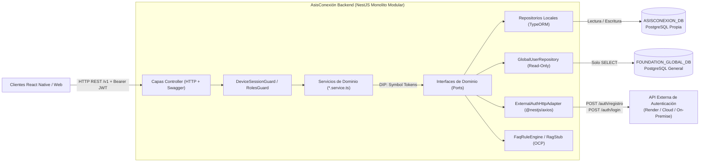

# AsisConexión Backend (MVP)

Backend **Monolito Modular en NestJS + TypeScript estricto** para **AsisConexión**, la puerta de entrada móvil (React Native) y Web de la **Fundación Asisco**.

Construido bajo metodología **Spec-Driven Development (SDD OpenAPI-First)** y gobernado por la Constitución del proyecto (`v1.0.0`): prohibición absoluta de `any`, principios **SOLID** estrictos con **Inversión de Dependencias (DIP)**, errores homologados **RFC 7807 (`application/problem+json`)**, paginación obligatoria para gama de entrada (**RT-01**), moderación humana previa (**RN-02**) y trazabilidad de consentimiento conforme a la **Ley 1581 de 2012** y **Ley 1098 de 2006** (Colombia).

---

## 1. ¿Qué se implementó en el proyecto?

Se completó la implementación integral del backend MVP organizada en **2 capas transversales** y **5 módulos de dominio independientes**:

1. **Infraestructura Transversal (`src/config/`, `src/common/`, `src/database/`)**:
   - **Validación tipada fail-fast** de variables de entorno (`env.validation.ts`).
   - **Persistencia Dual PostgreSQL** (`DatabaseModule`): conexión principal de lectura/escritura sobre `ASISCONEXION_DB` (`default`) y conexión condicional de **solo lectura** (`default_transaction_read_only=on`) sobre `FOUNDATION_GLOBAL_DB` (`global_db`).
   - **Autenticación por Sesión de Dispositivo con JWT** (`SessionAuthModule`, `SessionTokenService`, `DeviceSessionGuard`, `OptionalDeviceSessionGuard`, `RolesGuard`): emisión de tokens JWT únicos (`jti`) vinculados a `DeviceSession` en BD y verificación cruzada de rol `ADMIN`.
   - **Calidad y Seguridad**: filtro global RFC 7807 (`AllExceptionsFilter`), redacción recursiva de credenciales en logs (`redactSensitiveFields`), protección contra coerción booleana en consentimiento legal (`preserveRawConsentValue`) y paginación estándar `RT-01` (`PaginationQueryDto`, `PaginationMetaDto`).
   - **Migraciones y Semillas Idempotentes**: 4 migraciones SQL reversibles (`1761430000000`–`1761430300000`) y 3 seeders (`categories`, `redirection_links`, `faq_knowledge`).
2. **US1 — Identidad Híbrida y Sesiones (`AuthSessionModule`)**:
   - Registro (`/v1/auth/registro`) y sincronización/login (`/v1/auth/sync-session`) consumiendo cualquier API HTTP externa mediante `IExternalAuthAdapter`, cruzando con `FOUNDATION_GLOBAL_DB` y persistiendo transaccionalmente `UserAccount` (sin `clave`) + `DeviceSession` antes de firmar el `device_token`.
   - Sesiones rápidas anónimas por dispositivo (`/v1/sessions/anonymous`) vinculables posteriormente al registrarse.
3. **US2 — Foros Comunitarios (`SocialModule`)**:
   - Listado paginado de categorías (`/v1/categories`) y muro público exclusivamente con publicaciones `APPROVED` (`/v1/posts`), incluyendo resumen de reacciones y últimos 3 comentarios aprobados.
   - Creación de publicaciones y comentarios forzando `status = 'PENDING'` (`RN-02`) y reacciones alternables (`LIKE`, `SUPPORT`, `THANKS`) libres de condición de carrera.
4. **US3 — Moderación Humana Administrativa (`ModerationModule`)**:
   - Cola unificada paginada (`UNION ALL` sobre posts y comentarios en `PENDING`) y endpoints `PATCH` de aprobación/rechazo exclusivos para usuarios con rol `ADMIN` activo tanto en `ASISCONEXION_DB` como en `FOUNDATION_GLOBAL_DB`.
5. **US4 — Directorio de Módulos Satélites (`DirectoryModule`)**:
   - Catálogo paginado de enlaces activos (`SUMA 21`, `AULA UP`, `SAGA-UP`) con URLs HTTPS limpias para apertura nativa externa sin `iframe` ni superposición visual.
6. **US5 — Asistente Orientativo y Escalamiento a WhatsApp (`AssistantModule`)**:
   - Consulta de preguntas frecuentes filtrables por categoría (`/v1/assistant/faqs`) con *disclaimer* institucional obligatorio mediante el motor extensible `IAssistantEngineProvider` (`FaqRuleEngineProvider` en Fase 1 y `RagMultimodalProviderStub` preparado para `pgvector` + LLM en Fase 2).
   - Generación de enlace directo codificado hacia el canal humano oficial en WhatsApp (`/v1/assistant/escalate`).

---

## 2. Arquitectura del Proyecto

### 2.1 Topología de Monolito Modular y Persistencia Dual



### 2.2 Estructura de Directorios (`src/`)

```text
src/
├── main.ts                          # Bootstrap, ValidationPipe, AllExceptionsFilter, CORS y Swagger (/api/docs)
├── app.module.ts                    # Módulo raíz del Monolito Modular
├── config/
│   └── env.validation.ts            # Validación tipada de variables de entorno al arranque
├── common/
│   ├── auth/                        # SessionAuthModule (@Global), SessionTokenService (JWT) y lector de sesiones
│   ├── decorators/                  # @CurrentSession(), @Roles()
│   ├── dto/                         # PaginationQueryDto, PaginationMetaDto (RT-01)
│   ├── enums/                       # ModerationStatus, ReactionType
│   ├── filters/                     # AllExceptionsFilter (RFC 7807 application/problem+json)
│   ├── guards/                      # DeviceSessionGuard, OptionalDeviceSessionGuard, RolesGuard
│   └── utils/                       # redactSensitiveFields, preserveRawConsentValue
├── database/
│   ├── database.module.ts           # Conexión dual ('default' RW + 'global_db' Read-Only condicional)
│   ├── data-source.ts               # DataSource CLI exclusivo de ASISCONEXION_DB
│   ├── external-entities/           # GlobalUserViewEntity (external_user solo lectura)
│   ├── migrations/                  # 4 migraciones SQL reversibles
│   └── seeds/                       # Semillas idempotentes (Categorías, Directorio, FAQs)
└── modules/
    ├── auth-session/                # US1: Registro, login sincronizado y sesiones anónimas
    ├── social/                      # US2: Categorías, posts, comentarios y reacciones
    ├── moderation/                  # US3: Bandeja PENDING y aprobación/rechazo ADMIN
    ├── directory/                   # US4: Enlaces limpios a SUMA 21, AULA UP y SAGA-UP
    └── assistant/                   # US5: Motor FAQ (OCP Fase 1/2) y escalamiento WhatsApp
```

---

## 3. Aplicación de Principios SOLID e Inversión de Dependencias (DIP)

- **SRP (Responsabilidad Única)**: Separación estricta entre `*.controller.ts` (solo HTTP, DTOs y `@nestjs/swagger`), `*.service.ts` (reglas de negocio), `*.adapter.ts` (integración HTTP externa) y `*.repository.ts` (consultas TypeORM/SQL).
- **OCP (Abierto/Cerrado)**: `AssistantService` depende de `IAssistantEngineProvider` (`ASSISTANT_ENGINE_PROVIDER`). Cambiar `ASSISTANT_ENGINE=faq` a `ASSISTANT_ENGINE=rag` conmuta el proveedor en `AssistantModule` sin modificar controladores ni contratos HTTP.
- **LSP (Sustitución de Liskov)**: Con `USE_MOCK_EXTERNAL_SERVICES=true`, NestJS inyecta `ExternalAuthMockAdapter` y `GlobalUserMockRepository`, preservando idénticos contratos de retorno y excepciones (`401`, `409`, `502`).
- **ISP (Segregación de Interfaces)**: `PublicUserDto` expone únicamente `{ id, username, email, rol }`; la entidad `UserAccount` no posee columna `clave` y ningún DTO de creación acepta `status`.
- **DIP (Inversión de Dependencias)**: Ningún servicio conoce implementaciones concretas ni proveedores de infraestructura. En particular, `AuthSessionService` consume el puerto abstracto `IExternalAuthAdapter` (`EXTERNAL_AUTH_ADAPTER`), permitiendo autenticar contra **cualquier API HTTP externa** configurando `EXTERNAL_AUTH_API_URL` (o `RENDER_API_URL`) sin acoplar la lógica de dominio.

---

## 4. Catálogo de Endpoints (`/v1`)

| Módulo | Método y Ruta | Auth | Descripción |
|---|---|---|---|
| `AuthSession` | `POST /v1/auth/registro` | Bearer opcional | Registra en API externa, sincroniza `UserAccount` local y emite `device_token` JWT |
| `AuthSession` | `POST /v1/auth/sync-session` | Bearer opcional | Valida credenciales en API externa + BD General y emite `device_token` JWT |
| `AuthSession` | `POST /v1/sessions/anonymous` | Público | Crea sesión rápida de dispositivo con consentimiento Ley 1581 |
| `Social` | `GET /v1/categories` | Público | Lista categorías temáticas paginadas (`RT-01`) |
| `Social` | `GET /v1/posts` | Público | Lista únicamente publicaciones `APPROVED` con reacciones y comentarios recientes |
| `Social` | `POST /v1/posts` | `Bearer JWT` | Crea publicación forzando `status = 'PENDING'` (`RN-02`) |
| `Social` | `POST /v1/posts/:postId/comments` | `Bearer JWT` | Crea comentario en `PENDING` sobre publicación aprobada |
| `Social` | `POST /v1/posts/:postId/reactions` | `Bearer JWT` | Alterna (`toggle`) reacción `LIKE`, `SUPPORT` o `THANKS` |
| `Moderation` | `GET /v1/admin/moderation/pending` | `Bearer JWT` (`ADMIN`) | Cola paginada de publicaciones y comentarios en `PENDING` |
| `Moderation` | `PATCH /v1/admin/moderation/posts/:id/status` | `Bearer JWT` (`ADMIN`) | Aprueba (`APPROVED`) o rechaza (`REJECTED`) una publicación |
| `Moderation` | `PATCH /v1/admin/moderation/comments/:id/status` | `Bearer JWT` (`ADMIN`) | Aprueba (`APPROVED`) o rechaza (`REJECTED`) un comentario |
| `Directory` | `GET /v1/directory/links` | Público | Lista enlaces activos hacia módulos satélites (`SUMA 21`, `AULA UP`, `SAGA-UP`) |
| `Assistant` | `GET /v1/assistant/faqs` | Público | Lista FAQs filtrables por categoría con *disclaimer* obligatorio |
| `Assistant` | `POST /v1/assistant/escalate` | Público | Genera URL `https://wa.me/...` hacia atención humana oficial |

---

## 5. Desarrollo Paralelo con Mocks (`USE_MOCK_EXTERNAL_SERVICES=true`)

Para trabajar en paralelo con Frontend sin acceso a la API externa ni a `FOUNDATION_GLOBAL_DB`, activa `USE_MOCK_EXTERNAL_SERVICES=true` en `.env`. Cuentas semilla en memoria (clave: `ClaveAsisco2026`):
- `admin.asisco` / `admin@asisco.org` (`ADMIN`)
- `maria.acudiente` / `maria@prueba.com` (`ACUDIENTE`)
- `carlos.voluntario` / `carlos@asisco.org` (`VOLUNTARIO`)

---

## 6. Comandos Principales

```bash
# 1. Instalar dependencias y configurar variables de entorno
npm install
cp .env.example .env

# 2. Ejecutar migraciones y semillas idempotentes en ASISCONEXION_DB
npm run migration:run
npm run seed:dev

# 3. Levantar servidor en desarrollo (http://localhost:3000/v1)
npm run start:dev

# 4. Verificación de calidad, pruebas y exportación OpenAPI
npm run lint
npm run build
npm run test
npm run test:e2e
npm run openapi:export
```

- **Documentación interactiva Swagger (OpenAPI)**: `http://localhost:3000/api/docs`
