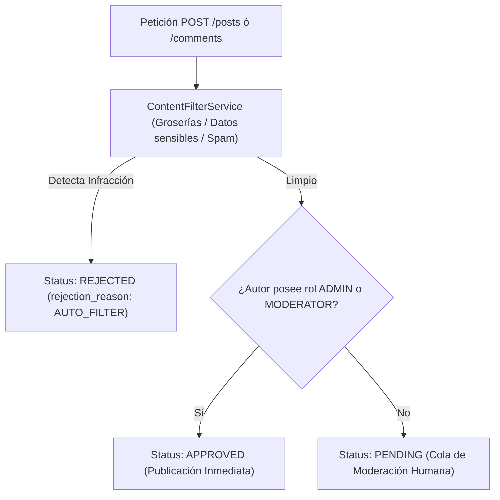

# Guía Técnica: Módulo Multimedia (Cloudinary), Muro de Publicaciones y Auto-moderación
## AsisConexión Backend (NestJS + TypeScript + TypeORM)

**Fecha:** 9 de noviembre de 2026  
**Repositorio:** `Asisconnection`  
**Rama:** `001-asisconexion-mvp`  
**Servidor de Producción:** `https://asisconection.onrender.com/v1`  
**Documentación OpenAPI:** `https://asisconection.onrender.com/api/docs`  

---

## 1. Resumen Ejecutivo de Nuevas Implementaciones

El backend de AsisConexión fue enriquecido con tres capacidades fundamentales para dar soporte al MVP de la aplicación comunitaria:

1. **Infraestructura de Almacenamiento Multimedia en la Nube (`MediaModule`):**
   - Servicio de subida de imágenes conectado a Cloudinary mediante streams en memoria RAM (`upload_stream`), eliminando el almacenamiento de binarios pesados en PostgreSQL (`ASISCONEXION_DB`) y resolviendo la volatilidad del sistema de archivos efímero de Render.
2. **Endpoints de Muro de Publicaciones por Perfil:**
   - `GET /v1/actors/me/posts`: Listado paginado de publicaciones aprobadas pertenecientes al usuario registrado autenticado.
   - `GET /v1/actors/:id/posts`: Listado paginado de publicaciones aprobadas de un perfil de tercero con resolución dual por `actor.id` o `actor.user_account_id` y control de errores RFC 7807 (404 si el perfil no existe).
3. **Auto-aprobación para Roles Privilegiados (`ADMIN` / `MODERATOR`):**
   - Publicaciones y comentarios emitidos por administradores o moderadores nacen con `status = 'APPROVED'` y se publican de forma inmediata en el feed, siempre que superen el filtro de seguridad de contenido automático.

---

## 2. Especificación de Endpoints y Contratos OpenAPI

### 2.1. Subida de Archivos Multimedia
* **Ruta:** `POST /v1/media/upload`
* **Autenticación:** Obligatoria (`Authorization: Bearer <device_token>`).
* **Content-Type:** `multipart/form-data` (campo binario: `file`).
* **Validaciones de Seguridad:**
  - Presencia obligatoria del archivo en la petición.
  - Tipos MIME permitidos: `image/jpeg`, `image/png`, `image/webp`.
  - Tamaño máximo: 5 MB (`5 * 1024 * 1024` bytes).
* **Respuesta Exitosa (`201 Created` — `UploadMediaResponseDto`):**
  ```json
  {
    "url": "https://res.cloudinary.com/demo/image/upload/v174/asisconexion/xyz.webp",
    "format": "webp",
    "bytes": 184520
  }
  ```
* **Manejo de Errores (RFC 7807):**
  - `400 Bad Request`: Formato no permitido, archivo ausente o tamaño excedido.
  - `401 Unauthorized`: Token de sesión ausente o inválido.
  - `502 Bad Gateway`: Servicio de Cloudinary no configurado o indisponible.

### 2.2. Publicaciones Propias Aprobadas
* **Ruta:** `GET /v1/actors/me/posts?page=1&limit=20`
* **Autenticación:** Obligatoria (`DeviceSessionGuard`). Exclusivo para cuentas registradas (`userAccountId !== null`).
* **Respuesta Exitosa (`200 OK` — `PostsPageDto`):**
  ```json
  {
    "data": [
      {
        "id": "ba386733-8641-4a07-86a1-04f981ae6b34",
        "category_id": "ad79925a-1098-48e0-84f4-955f418242c8",
        "content": "Mi publicación en el foro",
        "image_url": "https://res.cloudinary.com/.../img.webp",
        "media_urls": ["https://res.cloudinary.com/.../img.webp"],
        "author": {
          "actor_id": "9a794e81-7c76-4955-a5de-08d80f4c6c34",
          "display_name": "maria.acudiente",
          "role_label": "ACUDIENTE",
          "is_registered": true
        },
        "likes_count": 0,
        "comments_count": 0,
        "created_at": "2026-11-09T22:28:57.913Z"
      }
    ],
    "meta": {
      "page": 1,
      "limit": 20,
      "total_items": 1,
      "total_pages": 1,
      "has_next_page": false
    }
  }
  ```

### 2.3. Publicaciones de un Perfil Específico
* **Ruta:** `GET /v1/actors/:id/posts?page=1&limit=20`
* **Autenticación:** Pública.
* **Comportamiento:**
  - Consulta en PostgreSQL: `SELECT user_account_id FROM actors WHERE id = $1 OR user_account_id = $1 LIMIT 1`.
  - Si el actor no existe: responde `404 Not Found` (`"El perfil solicitado no existe."`).
  - Si el actor existe: retorna sus publicaciones con `status = 'APPROVED'`.

---

## 3. Lógica de Moderación en Dos Capas y Auto-aprobación

En concordancia con el principio constitucional RN-02 y la Ley 1581 de 2012, el flujo de creación de publicaciones y comentarios opera de la siguiente manera:



1. **Filtro Automático:** Todo texto es evaluado por `ContentFilterService` (patrón extensible OCP). Si infringe políticas comunitarias, se rechaza de inmediato con `status = 'REJECTED'` y mensaje explicativo al usuario.
2. **Evaluación de Roles Privilegiados:** Si el contenido es seguro y el emisor posee rol `ADMIN` (local o externo) o `MODERATOR` asignado por un administrador, el estado asignado es `ModerationStatus.APPROVED`.
3. **Usuarios Comunes:** El contenido seguro de usuarios regulares nace en `ModerationStatus.PENDING` para revisión en la bandeja de moderación humana (`GET /v1/admin/moderation/pending`).
4. **Consentimiento Legal Requerido:** Si una publicación adjunta imágenes (`media_urls.length > 0`), se exige que el usuario tenga registrado `session.consentAcceptedAt !== null` conforme a Ley 1581 y Ley 1098. En caso contrario, se rechaza con `403 Forbidden`.

---

## 4. Configuración del Servicio en Render

Para habilitar la subida de imágenes en el entorno desplegado en Render, deben agregarse las siguientes variables en el dashboard del servicio:

| Variable | Descripción | Ejemplo |
| :--- | :--- | :--- |
| `CLOUDINARY_CLOUD_NAME` | Nombre de la cuenta/cloud en Cloudinary | `dxyz123abc` |
| `CLOUDINARY_API_KEY` | Clave pública de la API | `123456789012345` |
| `CLOUDINARY_API_SECRET` | Secreto privado de autenticación | `aBcDeFgHiJkLmNoPqRsTuVwXyZ` |
| `CLOUDINARY_FOLDER` | Carpeta contenedora (opcional) | `asisconexion` |

> [!NOTE]
> Si estas variables no están presentes, el backend continuará funcionando normalmente para todas las demás operaciones sociales y responderá `502 Bad Gateway` controlado con RFC 7807 únicamente si un usuario intenta subir un archivo en `POST /v1/media/upload`.

---

## 5. Reporte de Pruebas Automatizadas

```bash
> asisconexion-backend@1.0.0 lint
> eslint "{src,test}/**/*.ts" --max-warnings=0
✨ 0 errores, 0 advertencias.

> asisconexion-backend@1.0.0 test
PASS test/unit/posts-profile.spec.ts
PASS test/unit/assistant-ocp-and-redact.spec.ts
PASS src/modules/auth-session/actors.service.spec.ts

Test Suites: 3 passed, 3 total
Tests:       19 passed, 19 total
Snapshots:   0 total
```
