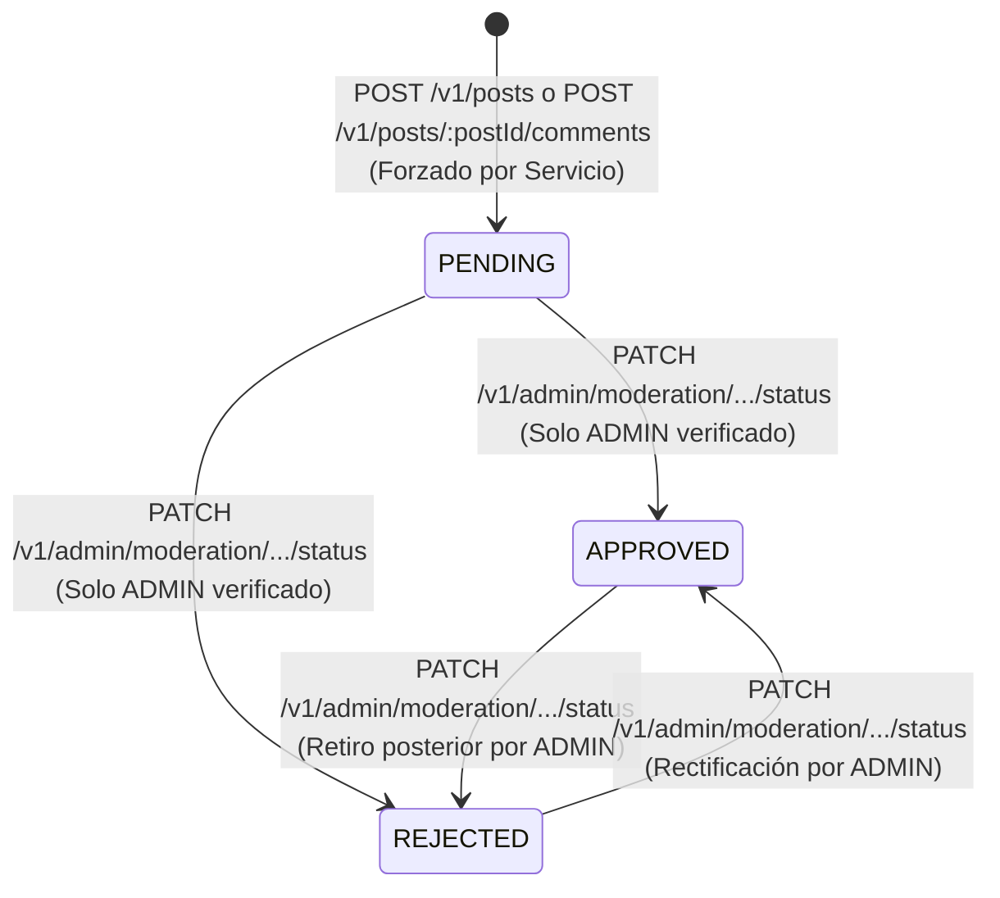

# Phase 1 Data Model: AsisConexión MVP (Persistencia Dual PostgreSQL)

**Feature**: `001-asisconexion-mvp`
**Date**: 2026-10-25
**DataSources**:
1. **`global_db` (`FOUNDATION_GLOBAL_DB`)**: PostgreSQL externo — **Solo lectura** (`synchronize: false`, `migrationsRun: false`).
2. **`default` (`ASISCONEXION_DB`)**: PostgreSQL propio — **Lectura/Escritura principal** con migraciones versionadas TypeORM.

---

## 1. Diagrama Entidad-Relación (Topología Dual)

```mermaid
erDiagram
    EXTERNAL_USER {
        varchar id PK "FOUNDATION_GLOBAL_DB (Read-Only)"
        varchar username
        varchar email
        varchar rol
    }

    USER_ACCOUNT {
        uuid id PK
        varchar external_user_id UK "Nullable - logical ref to EXTERNAL_USER.id"
        varchar username UK "VARCHAR(80) NOT NULL"
        varchar email UK "VARCHAR(120) NOT NULL"
        varchar rol "VARCHAR(40) NOT NULL"
        boolean is_active "DEFAULT true"
        timestamp last_synced_at "NOT NULL"
        timestamp created_at "NOT NULL"
    }

    DEVICE_SESSION {
        uuid id PK
        uuid user_account_id FK "Nullable ON DELETE SET NULL"
        varchar device_token UK "NOT NULL"
        varchar nickname "VARCHAR(50) Nullable"
        varchar role_tag "VARCHAR(40) Nullable"
        timestamp consent_accepted_at "Nullable in DDL / Required by App Rule (Ley 1581)"
        timestamp created_at "NOT NULL"
    }

    CATEGORY {
        uuid id PK
        varchar name UK "VARCHAR(80) NOT NULL"
        text description "NOT NULL"
        timestamp created_at "NOT NULL"
    }

    POST {
        uuid id PK
        uuid device_id FK "NOT NULL -> DEVICE_SESSION.id"
        uuid user_account_id FK "Nullable -> USER_ACCOUNT.id"
        uuid category_id FK "NOT NULL -> CATEGORY.id"
        text content "NOT NULL"
        varchar image_url "Nullable"
        enum status "PENDING | APPROVED | REJECTED (DEFAULT PENDING)"
        timestamp created_at "NOT NULL"
        timestamp updated_at "NOT NULL"
    }

    COMMENT {
        uuid id PK
        uuid post_id FK "NOT NULL ON DELETE CASCADE"
        uuid device_id FK "NOT NULL -> DEVICE_SESSION.id"
        uuid user_account_id FK "Nullable -> USER_ACCOUNT.id"
        text content "NOT NULL"
        enum status "PENDING | APPROVED | REJECTED (DEFAULT PENDING)"
        timestamp created_at "NOT NULL"
    }

    REACTION {
        uuid id PK
        uuid post_id FK "NOT NULL ON DELETE CASCADE"
        uuid device_id FK "NOT NULL -> DEVICE_SESSION.id"
        uuid user_account_id FK "Nullable -> USER_ACCOUNT.id"
        varchar type "VARCHAR(20) LIKE | SUPPORT | THANKS"
        timestamp created_at "NOT NULL"
    }

    REDIRECTION_LINK {
        uuid id PK
        varchar project_name "VARCHAR(100) NOT NULL"
        varchar url "VARCHAR NOT NULL"
        text description "NOT NULL"
        boolean is_active "DEFAULT true"
        timestamp created_at "NOT NULL"
    }

    FAQ_KNOWLEDGE {
        uuid id PK
        varchar question "VARCHAR NOT NULL"
        text answer "NOT NULL"
        varchar category "VARCHAR(60) NOT NULL"
        timestamp created_at "NOT NULL"
    }

    EXTERNAL_USER ||--o| USER_ACCOUNT : "sincroniza (lógico entre BDs)"
    USER_ACCOUNT ||--o{ DEVICE_SESSION : "vincula (ON DELETE SET NULL)"
    USER_ACCOUNT ||--o{ POST : "autor registrado (opcional)"
    USER_ACCOUNT ||--o{ COMMENT : "autor registrado (opcional)"
    USER_ACCOUNT ||--o{ REACTION : "autor registrado (opcional)"
    DEVICE_SESSION ||--o{ POST : "publica desde dispositivo"
    DEVICE_SESSION ||--o{ COMMENT : "comenta desde dispositivo"
    DEVICE_SESSION ||--o{ REACTION : "reacciona desde dispositivo"
    CATEGORY ||--o{ POST : "clasifica"
    POST ||--o{ COMMENT : "contiene (ON DELETE CASCADE)"
    POST ||--o{ REACTION : "recibe (ON DELETE CASCADE)"
```

---

## 2. Entidad Externa: `FOUNDATION_GLOBAL_DB` (`DataSource: 'global_db'`)

### 2.1 `GlobalUserViewEntity` -> Tabla/Vista `external_user` (Configurable por entorno)
- **Ubicación en código**: `src/database/external-entities/global-user.view-entity.ts`
- **Modo de acceso**: Solo lectura (`SELECT` únicamente a través de `GlobalUserRepository`).
- **Atributos**:
  | Campo | Tipo PostgreSQL | Restricciones | Descripción |
  |-------|----------------|---------------|-------------|
  | `id` | `VARCHAR` | PK (lectura) | Identificador único del usuario en la BD General (o `username` si actúa como clave natural). |
  | `username` | `VARCHAR` | NOT NULL | Nombre de usuario fundacional (ej. `"maria.acudiente"`). |
  | `email` | `VARCHAR` | NOT NULL | Correo electrónico registrado en el ecosistema general. |
  | `rol` | `VARCHAR` | NOT NULL | Rol maestro (`ACUDIENTE`, `ADMIN`, `VOLUNTARIO`, `INVERSOR`, etc.). |

---

## 3. Entidades Propias Persistentes: `ASISCONEXION_DB` (`DataSource: 'default'`)

### 3.1 `UserAccount` (`user_accounts`)
- **Ubicación**: `src/modules/auth-session/entities/user-account.entity.ts`
- **Regla de seguridad constitucional (ISP)**: **Jamás** incluye columna ni propiedad `clave` / `password_hash`.
- **Columnas e Índices**:
  | Columna | Tipo | Nulabilidad / Default | Restricciones / Índices |
  |---------|------|-----------------------|-------------------------|
  | `id` | `UUID` | NOT NULL, `uuid_generate_v4()` | `PK` |
  | `external_user_id` | `VARCHAR(120)` | NULLABLE | `UNIQUE` (`UQ_user_accounts_external_user_id`) |
  | `username` | `VARCHAR(80)` | NOT NULL | `UNIQUE` (`UQ_user_accounts_username`) |
  | `email` | `VARCHAR(120)` | NOT NULL | `UNIQUE` (`UQ_user_accounts_email`) |
  | `rol` | `VARCHAR(40)` | NOT NULL | Valores esperados: `ACUDIENTE`, `ADMIN`, `VOLUNTARIO`, `INVERSOR`, `BENEFICIARIO` |
  | `is_active` | `BOOLEAN` | NOT NULL, `DEFAULT true` | Índice de filtrado de cuentas activas |
  | `last_synced_at` | `TIMESTAMPTZ` | NOT NULL | Actualizado en cada `/v1/auth/registro` o `/v1/auth/sync-session` |
  | `created_at` | `TIMESTAMPTZ` | NOT NULL, `DEFAULT now()` | `@CreateDateColumn()` |

### 3.2 `DeviceSession` (`device_sessions`)
- **Ubicación**: `src/modules/auth-session/entities/device-session.entity.ts`
- **Regla legal (Ley 1581 / Ley 1098)**: La lógica de aplicación exige `accept_consent === true` y asigna `consent_accepted_at = NOW()` al crear cualquier sesión o vincular actividad con imágenes de menores/beneficiarios.
- **Columnas, Claves Foráneas e Índices**:
  | Columna | Tipo | Nulabilidad / Default | Restricciones / Relaciones |
  |---------|------|-----------------------|----------------------------|
  | `id` | `UUID` | NOT NULL, `uuid_generate_v4()` | `PK` |
  | `user_account_id` | `UUID` | NULLABLE | `FK -> user_accounts.id` (`ON DELETE SET NULL`), `IDX_device_sessions_user_account_id` |
  | `device_token` | `VARCHAR(512)` | NOT NULL | `UNIQUE` (`UQ_device_sessions_device_token`) |
  | `nickname` | `VARCHAR(50)` | NULLABLE | Si `user_account_id != null`, toma `UserAccount.username` por defecto |
  | `role_tag` | `VARCHAR(40)` | NULLABLE | Si `user_account_id != null`, toma `UserAccount.rol` por defecto |
  | `consent_accepted_at` | `TIMESTAMPTZ` | NULLABLE (DDL) / Requerido (Dominio) | Trazabilidad obligatoria Ley 1581 de 2012 y Ley 1098 de 2006 |
  | `created_at` | `TIMESTAMPTZ` | NOT NULL, `DEFAULT now()` | `@CreateDateColumn()` |

### 3.3 `Category` (`categories`)
- **Ubicación**: `src/modules/social/entities/category.entity.ts`
- **Columnas**:
  | Columna | Tipo | Nulabilidad / Default | Restricciones |
  |---------|------|-----------------------|---------------|
  | `id` | `UUID` | NOT NULL, `uuid_generate_v4()` | `PK` |
  | `name` | `VARCHAR(80)` | NOT NULL | `UNIQUE` (`UQ_categories_name`) |
  | `description` | `TEXT` | NOT NULL | Descripción temática del foro |
  | `created_at` | `TIMESTAMPTZ` | NOT NULL, `DEFAULT now()` | `@CreateDateColumn()` |

### 3.4 `Post` (`posts`)
- **Ubicación**: `src/modules/social/entities/post.entity.ts`
- **Enum `ModerationStatus`**: `'PENDING' | 'APPROVED' | 'REJECTED'`
- **Columnas, Claves Foráneas e Índices**:
  | Columna | Tipo | Nulabilidad / Default | Restricciones / Índices |
  |---------|------|-----------------------|-------------------------|
  | `id` | `UUID` | NOT NULL, `uuid_generate_v4()` | `PK` |
  | `device_id` | `UUID` | NOT NULL | `FK -> device_sessions.id` (`ON DELETE RESTRICT`) |
  | `user_account_id` | `UUID` | NULLABLE | `FK -> user_accounts.id` (`ON DELETE SET NULL`) |
  | `category_id` | `UUID` | NOT NULL | `FK -> categories.id` (`ON DELETE RESTRICT`) |
  | `content` | `TEXT` | NOT NULL | Validado `1..2000` caracteres sin vacío |
  | `image_url` | `VARCHAR(500)` | NULLABLE | URL HTTPS válida; exige `consent_accepted_at` no nulo en `DeviceSession` |
  | `status` | `ENUM` | NOT NULL, `DEFAULT 'PENDING'` | `IDX_posts_status`, compuesto `IDX_posts_status_category_created (status, category_id, created_at DESC)` |
  | `created_at` | `TIMESTAMPTZ` | NOT NULL, `DEFAULT now()` | `IDX_posts_created_at` |
  | `updated_at` | `TIMESTAMPTZ` | NOT NULL, `DEFAULT now()` | `@UpdateDateColumn()` |

### 3.5 `Comment` (`comments`)
- **Ubicación**: `src/modules/social/entities/comment.entity.ts`
- **Columnas, Claves Foráneas e Índices**:
  | Columna | Tipo | Nulabilidad / Default | Restricciones / Índices |
  |---------|------|-----------------------|-------------------------|
  | `id` | `UUID` | NOT NULL, `uuid_generate_v4()` | `PK` |
  | `post_id` | `UUID` | NOT NULL | `FK -> posts.id` (`ON DELETE CASCADE`) |
  | `device_id` | `UUID` | NOT NULL | `FK -> device_sessions.id` (`ON DELETE RESTRICT`) |
  | `user_account_id` | `UUID` | NULLABLE | `FK -> user_accounts.id` (`ON DELETE SET NULL`) |
  | `content` | `TEXT` | NOT NULL | Validado `1..1000` caracteres |
  | `status` | `ENUM` | NOT NULL, `DEFAULT 'PENDING'` | `IDX_comments_status`, compuesto `IDX_comments_post_status_created (post_id, status, created_at ASC)` |
  | `created_at` | `TIMESTAMPTZ` | NOT NULL, `DEFAULT now()` | `@CreateDateColumn()` |

### 3.6 `Reaction` (`reactions`)
- **Ubicación**: `src/modules/social/entities/reaction.entity.ts`
- **Enum `ReactionType`**: `'LIKE' | 'SUPPORT' | 'THANKS'`
- **Columnas y Restricciones**:
  | Columna | Tipo | Nulabilidad / Default | Restricciones / Índices |
  |---------|------|-----------------------|-------------------------|
  | `id` | `UUID` | NOT NULL, `uuid_generate_v4()` | `PK` |
  | `post_id` | `UUID` | NOT NULL | `FK -> posts.id` (`ON DELETE CASCADE`) |
  | `device_id` | `UUID` | NOT NULL | `FK -> device_sessions.id` (`ON DELETE CASCADE`) |
  | `user_account_id` | `UUID` | NULLABLE | `FK -> user_accounts.id` (`ON DELETE SET NULL`) |
  | `type` | `VARCHAR(20)` | NOT NULL | Valores permitidos: `LIKE`, `SUPPORT`, `THANKS` |
  | `created_at` | `TIMESTAMPTZ` | NOT NULL, `DEFAULT now()` | `@CreateDateColumn()` |
  - **Restricción única obligatoria**: `UQ_reactions_post_device_type UNIQUE (post_id, device_id, type)`.

### 3.7 `RedirectionLink` (`redirection_links`)
- **Ubicación**: `src/modules/directory/entities/redirection-link.entity.ts`
- **Columnas**:
  | Columna | Tipo | Nulabilidad / Default | Restricciones / Índices |
  |---------|------|-----------------------|-------------------------|
  | `id` | `UUID` | NOT NULL, `uuid_generate_v4()` | `PK` |
  | `project_name` | `VARCHAR(100)` | NOT NULL | Ej. `SUMA 21`, `AULA UP`, `SAGA-UP` |
  | `url` | `VARCHAR(500)` | NOT NULL | URL HTTPS externa limpia (apertura nativa sin iframe/WebView superpuesto) |
  | `description` | `TEXT` | NOT NULL | Descripción breve para tarjeta ligera |
  | `is_active` | `BOOLEAN` | NOT NULL, `DEFAULT true` | `IDX_redirection_links_is_active` |
  | `created_at` | `TIMESTAMPTZ` | NOT NULL, `DEFAULT now()` | `@CreateDateColumn()` |

### 3.8 `FaqKnowledge` (`faq_knowledge`)
- **Ubicación**: `src/modules/assistant/entities/faq-knowledge.entity.ts`
- **Columnas**:
  | Columna | Tipo | Nulabilidad / Default | Restricciones / Índices |
  |---------|------|-----------------------|-------------------------|
  | `id` | `UUID` | NOT NULL, `uuid_generate_v4()` | `PK` |
  | `question` | `VARCHAR(300)` | NOT NULL | Pregunta frecuente oficial |
  | `answer` | `TEXT` | NOT NULL | Respuesta orientativa verificada por la Fundación |
  | `category` | `VARCHAR(60)` | NOT NULL | `IDX_faq_knowledge_category` |
  | `created_at` | `TIMESTAMPTZ` | NOT NULL, `DEFAULT now()` | `@CreateDateColumn()` |

---

## 4. Máquina de Estados de Moderación Humana (RN-02)

Aplica de forma idéntica a `Post.status` y `Comment.status`:

- **Invariante 1**: Ningún DTO de creación (`CreatePostDto`, `CreateCommentDto`) acepta propiedad `status` (`forbidNonWhitelisted: true`).
- **Invariante 2**: Toda consulta pública (`GET /v1/posts`, comentarios asociados, reacciones permitidas) filtra obligatoriamente `WHERE status = 'APPROVED'`.
