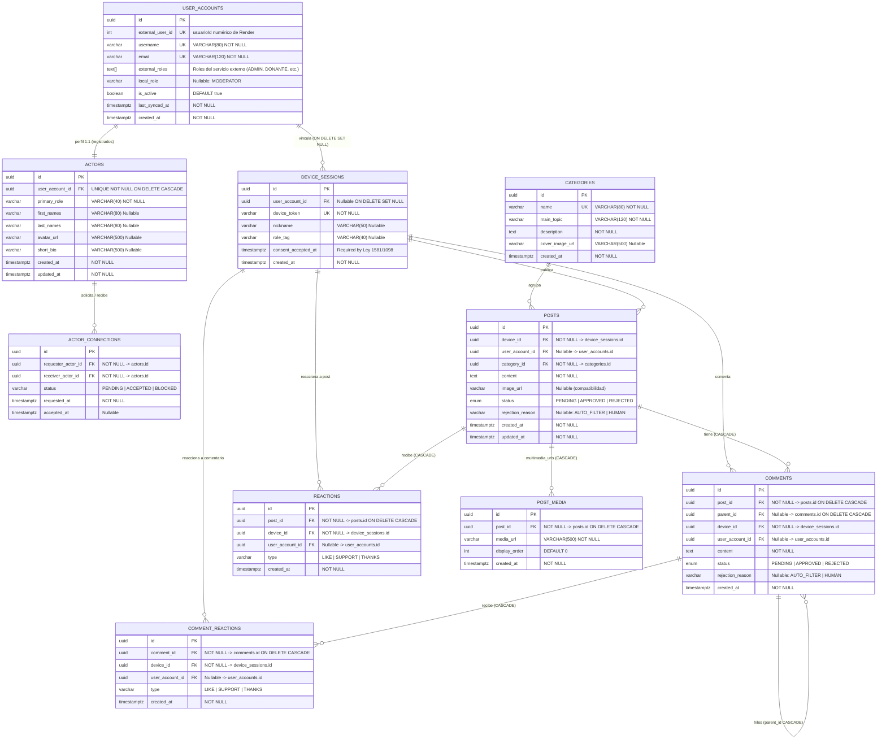
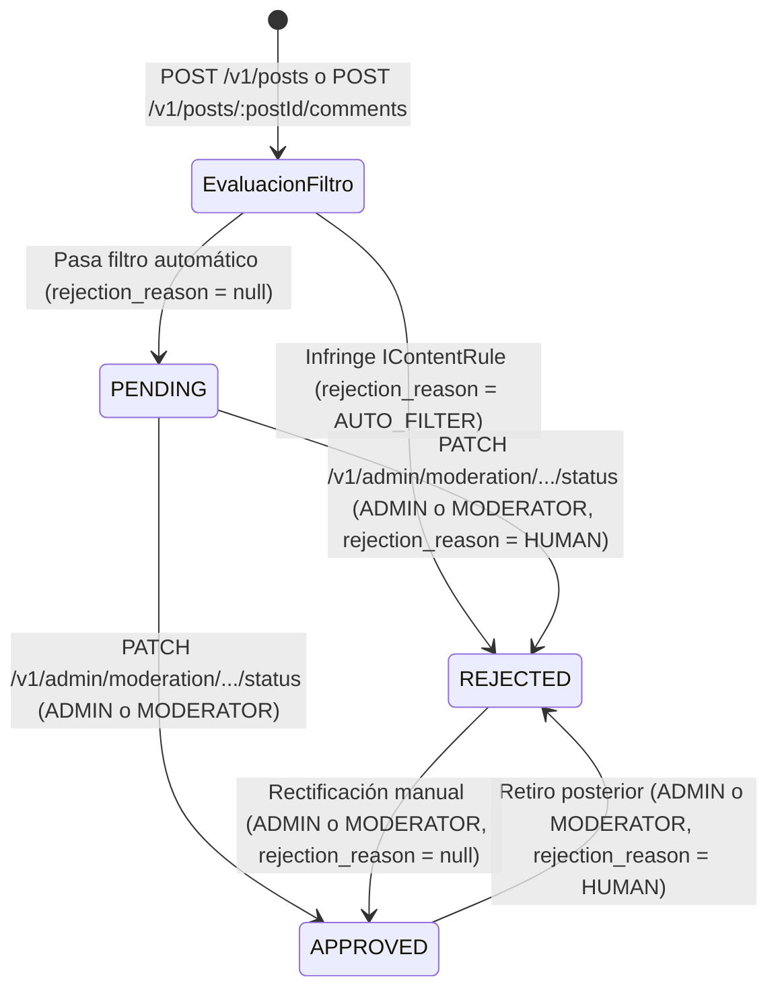

# Phase 1 Data Model: AsisConexión MVP (v2 — Persistencia Única PostgreSQL `ASISCONEXION_DB`)

**Feature**: `001-asisconexion-mvp`
**Date**: 2026-10-27
**DataSource**:
- **`default` (`ASISCONEXION_DB`)**: Única base de datos PostgreSQL del proyecto — **Lectura/Escritura principal** con identificadores UUID y migraciones versionadas TypeORM. Se elimina por completo `FOUNDATION_GLOBAL_DB`; la identidad fundacional se sincroniza por HTTP desde el servicio central en Render/Supabase (`https://proyecto-integrador-backend-g2.onrender.com`).

---

## 1. Diagrama Entidad-Relación (`ASISCONEXION_DB`)

---

## 2. Especificación de Tablas (`ASISCONEXION_DB`)

### 2.1 `UserAccount` (`user_accounts`)
- **Ubicación**: `src/modules/auth-session/entities/user-account.entity.ts`
- **Columnas**:
  | Columna | Tipo PostgreSQL | Nulabilidad / Default | Descripción |
  |---------|----------------|-----------------------|-------------|
  | `id` | `UUID` | NOT NULL, PK | Identificador local UUID |
  | `external_user_id` | `INTEGER` | NULLABLE, UNIQUE | `usuarioId` numérico retornado por el servicio en Render |
  | `username` | `VARCHAR(80)` | NOT NULL, UNIQUE | Nombre de usuario sincronizado |
  | `email` | `VARCHAR(120)` | NOT NULL, UNIQUE | Correo electrónico sincronizado |
  | `rol` | `VARCHAR(40)` | NOT NULL | Rol principal para compatibilidad rápida (primer elemento de `external_roles`) |
  | `external_roles` | `TEXT[]` | NOT NULL, `DEFAULT '{}'` | Arreglo de roles provenientes de Render (`['ADMIN']`, `['DONANTE']`, etc.) |
  | `local_role` | `VARCHAR(40)` | NULLABLE | Rol global local en AsisConexión (`'MODERATOR'` o `NULL`) asignado solo por un `ADMIN` |
  | `is_active` | `BOOLEAN` | NOT NULL, `DEFAULT true` | Estado de la cuenta local |
  | `last_synced_at` | `TIMESTAMPTZ` | NOT NULL | Marca de última validación con Render |
  | `created_at` | `TIMESTAMPTZ` | NOT NULL, `DEFAULT now()` | Fecha de alta local |

### 2.2 `Actor` (`actors`)
- **Ubicación**: `src/modules/auth-session/entities/actor.entity.ts`
- **Regla de negocio**: Exclusivo para usuarios registrados (relación 1:1 con `UserAccount`). Las sesiones anónimas no tienen registro en `actors`.
- **Columnas**:
  | Columna | Tipo PostgreSQL | Nulabilidad / Default | Descripción |
  |---------|----------------|-----------------------|-------------|
  | `id` | `UUID` | NOT NULL, PK | Identificador del perfil Actor |
  | `user_account_id` | `UUID` | NOT NULL, UNIQUE, FK | Referencia 1:1 a `user_accounts.id` (`ON DELETE CASCADE`) |
  | `primary_role` | `VARCHAR(40)` | NOT NULL | Rol comunitario visible del actor |
  | `first_names` | `VARCHAR(80)` | NULLABLE | Nombres del usuario |
  | `last_names` | `VARCHAR(80)` | NULLABLE | Apellidos del usuario |
  | `avatar_url` | `VARCHAR(500)` | NULLABLE | URL de imagen de avatar |
  | `short_bio` | `VARCHAR(500)` | NULLABLE | Biografía corta |
  | `created_at` | `TIMESTAMPTZ` | NOT NULL, `DEFAULT now()` | Creación del perfil |
  | `updated_at` | `TIMESTAMPTZ` | NOT NULL, `DEFAULT now()` | Última actualización |

### 2.3 `ActorConnection` (`actor_connections`)
- **Ubicación**: `src/modules/auth-session/entities/actor-connection.entity.ts`
- **Columnas**:
  | Columna | Tipo PostgreSQL | Nulabilidad / Default | Descripción |
  |---------|----------------|-----------------------|-------------|
  | `id` | `UUID` | NOT NULL, PK | Identificador de la conexión |
  | `requester_actor_id` | `UUID` | NOT NULL, FK | `actors.id` que envía la solicitud (`ON DELETE CASCADE`) |
  | `receiver_actor_id` | `UUID` | NOT NULL, FK | `actors.id` que recibe la solicitud (`ON DELETE CASCADE`) |
  | `status` | `VARCHAR(20)` | NOT NULL, `DEFAULT 'PENDING'` | `'PENDING' | 'ACCEPTED' | 'BLOCKED'` |
  | `requested_at` | `TIMESTAMPTZ` | NOT NULL, `DEFAULT now()` | Fecha de solicitud |
  | `accepted_at` | `TIMESTAMPTZ` | NULLABLE | Fecha de aceptación |
  - **Restricción única**: `UQ_actor_connections_pair UNIQUE (requester_actor_id, receiver_actor_id)`.

### 2.4 `Category` (`categories`)
- **Ubicación**: `src/modules/social/entities/category.entity.ts`
- **Regla**: Todos los foros son públicos (no existen foros privados).
- **Columnas**: `id` (`UUID PK`), `name` (`VARCHAR(80) UNIQUE`), `main_topic` (`VARCHAR(120) NOT NULL DEFAULT 'General'`), `description` (`TEXT NOT NULL`), `cover_image_url` (`VARCHAR(500) NULLABLE`), `created_at` (`TIMESTAMPTZ`).

### 2.5 `Post` (`posts`) y `PostMedia` (`post_media`)
- **Ubicación**: `src/modules/social/entities/post.entity.ts` y `post-media.entity.ts`
- **`Post`**: Añade `rejection_reason` (`VARCHAR(40) NULLABLE`: `'AUTO_FILTER' | 'HUMAN' | null`) y relación `OneToMany` con `PostMedia` (`media`). Conserva `image_url` sincronizada con la primera URL de `media_urls` para compatibilidad retroactiva.
- **`PostMedia`**: Almacena el arreglo de URLs multimedia (`id` UUID, `post_id` FK `ON DELETE CASCADE`, `media_url` `VARCHAR(500) NOT NULL`, `display_order` `INT DEFAULT 0`, `created_at`).

### 2.6 `Comment` (`comments`) y `CommentReaction` (`comment_reactions`)
- **Ubicación**: `src/modules/social/entities/comment.entity.ts` y `comment-reaction.entity.ts`
- **`Comment`**: Añade `parent_id` (`UUID NULLABLE FK -> comments.id ON DELETE CASCADE`) para soportar hilos de respuesta y `rejection_reason` (`VARCHAR(40) NULLABLE`: `'AUTO_FILTER' | 'HUMAN' | null`).
- **`CommentReaction`**: Permite reaccionar (`LIKE`, `SUPPORT`, `THANKS`) a comentarios aprobados con unicidad `UQ_comment_reactions_comment_device_type UNIQUE (comment_id, device_id, type)`.

---

## 3. Máquina de Estados de Moderación en Dos Capas (`ContentFilterService` + `RN-02`)

