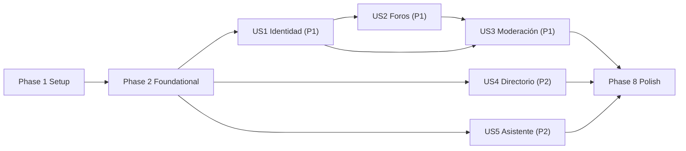

---

description: "Lista de tareas ejecutable para AsisConexión MVP — Backend Monolito Modular con Persistencia Dual"
---

# Tasks: AsisConexión MVP — Backend Monolito Modular con Persistencia Dual

**Input**: Design documents from `specs/001-asisconexion-mvp/`

**Prerequisites**: plan.md, spec.md, research.md, data-model.md, contracts/openapi.yaml, contracts/external-integrations.md, quickstart.md

**Tests**: La especificación no solicita explícitamente TDD ni suites por historia, así que no se generan tareas de prueba por historia. La infraestructura Jest/Supertest queda configurada (T005) para que `npm run test` y `npm run test:e2e` funcionen y puedan añadirse pruebas después.

**Organization**: Las tareas se agrupan por historia de usuario (US1–US5 de spec.md) para implementar y validar cada incremento de forma independiente.

## Format: `[ID] [P?] [Story] Description`

- **[P]**: Puede ejecutarse en paralelo (archivos distintos, sin dependencias con tareas incompletas del mismo bloque)
- **[Story]**: Historia de usuario a la que pertenece (US1–US5)
- Cada tarea incluye rutas exactas de archivo

## Path Conventions

- **NestJS Modular Monolith**: `src/config/`, `src/common/`, `src/database/`, `src/modules/<module>/` y `test/` en la raíz del repositorio (`/Users/press/documents/asisconnection`)
- Prefijo HTTP global `v1` (los controladores declaran rutas sin `v1`); Swagger en `/api/docs`
- Complemento al árbol de plan.md: `src/common/auth/` (lector de sesiones + servicio JWT + módulo global de autenticación) y `src/common/enums/` (enums compartidos entre Social y Moderation), necesarios para que los guards transversales no dependan de módulos de dominio (DIP)

---

## Phase 1: Setup (Shared Infrastructure)

**Purpose**: Inicializar el proyecto NestJS + TypeScript estricto en la raíz del repositorio

- [X] T001 Inicializar proyecto NestJS directamente en la raíz (sin crear subcarpeta) creando `package.json` (name `asisconexion-backend`, `engines.node >= 20.11`) y `nest-cli.json` (`sourceRoot: "src"`). Dependencias: `@nestjs/common`, `@nestjs/core`, `@nestjs/platform-express`, `@nestjs/config`, `@nestjs/jwt`, `@nestjs/typeorm`, `@nestjs/swagger`, `@nestjs/axios`, `typeorm`, `pg`, `axios`, `class-validator`, `class-transformer`, `reflect-metadata`, `rxjs`, `dotenv`. DevDependencies: `@nestjs/cli`, `@nestjs/schematics`, `@nestjs/testing`, `typescript`, `ts-node`, `tsconfig-paths`, `@types/node`, `@types/express`, `jest`, `ts-jest`, `@types/jest`, `supertest`, `@types/supertest`, `eslint`, `typescript-eslint`, `eslint-config-prettier`, `prettier`. Scripts: `build`, `start`, `start:dev`, `start:prod`, `lint` (`eslint "{src,test}/**/*.ts" --max-warnings=0`), `format`, `test` (`jest --passWithNoTests`), `test:e2e` (`jest --config ./test/jest-e2e.json --passWithNoTests`), `typeorm` (`typeorm-ts-node-commonjs -d src/database/data-source.ts`), `migration:run`, `migration:revert`, `migration:generate`, `seed:dev` (`ts-node -r tsconfig-paths/register src/database/seeds/run-seeds.ts`)
- [X] T002 Configurar `tsconfig.json` y `tsconfig.build.json` con `strict: true`, `noImplicitAny: true`, `strictNullChecks: true`, `noUncheckedIndexedAccess: true`, `emitDecoratorMetadata: true`, `experimentalDecorators: true`, `target: ES2022`, `module: commonjs`, `outDir: dist`, excluyendo `test` y `dist` en build
- [X] T003 [P] Configurar ESLint flat config en `eslint.config.mjs` (`typescript-eslint` recommendedTypeChecked, `@typescript-eslint/no-explicit-any: "error"`, `@typescript-eslint/no-unsafe-*: "error"`, `eslint-config-prettier`) y Prettier en `.prettierrc` (`singleQuote: true`, `trailingComma: "all"`, `printWidth: 100`)
- [X] T004 [P] Crear `.env.example` con todas las variables de quickstart.md más `RENDER_REGISTER_PATH=/auth/registro`, `RENDER_LOGIN_PATH=/auth/login`, `ASSISTANT_ENGINE=faq` y `CORS_ORIGINS=http://localhost:8081,http://localhost:5173` (sin secretos reales)
- [X] T005 [P] Configurar Jest: `jest.config.ts` (ts-jest, `rootDir: "."`, `roots: ["<rootDir>/src", "<rootDir>/test/unit", "<rootDir>/test/integration"]`, `testRegex: ".*\\.spec\\.ts$"`) y `test/jest-e2e.json` (`testRegex: ".e2e-spec.ts$"`, `rootDir: "."`, `roots: ["<rootDir>/contract"]`), creando las carpetas `test/unit/`, `test/integration/` y `test/contract/` con un `.gitkeep`

---

## Phase 2: Foundational (Blocking Prerequisites)

**Purpose**: Configuración validada, persistencia dual, manejo de errores RFC 7807, paginación RT-01 y autenticación transversal por dispositivo, necesarios para todas las historias

**⚠️ CRITICAL**: Ninguna historia de usuario puede empezar hasta completar esta fase

- [X] T006 Implementar validación tipada de entorno en `src/config/env.validation.ts`: clase `EnvironmentVariables` con `class-validator` (`PORT` default 3000, `NODE_ENV`, `DB_LOCAL_URL` requerido, `DB_GLOBAL_URL` requerido salvo `USE_MOCK_EXTERNAL_SERVICES=true` vía `@ValidateIf`, `RENDER_API_URL` requerido salvo mocks y aceptando el alias `RENDER_AUTH_API_URL`, `RENDER_REGISTER_PATH` default `/auth/registro`, `RENDER_LOGIN_PATH` default `/auth/login`, `RENDER_HTTP_TIMEOUT_MS` default 5000, `USE_MOCK_EXTERNAL_SERVICES` boolean default false, `JWT_SECRET` `@MinLength(32)`, `JWT_EXPIRES_IN` default `30d`, `WHATSAPP_SUPPORT_PHONE` solo dígitos, `WHATSAPP_DEFAULT_MESSAGE`, `ASSISTANT_ENGINE` en `faq|rag` default `faq`, `CORS_ORIGINS` opcional). Exportar `validate(config: Record<string, unknown>): EnvironmentVariables` con `plainToInstance` + `validateSync`, normalizando el alias de Render y lanzando error descriptivo (fail-fast)
- [X] T007 [P] Crear enums compartidos en `src/common/enums/moderation-status.enum.ts` (`PENDING`, `APPROVED`, `REJECTED`) y `src/common/enums/reaction-type.enum.ts` (`LIKE`, `SUPPORT`, `THANKS`)
- [X] T008 [P] Crear paginación RT-01 en `src/common/dto/pagination-query.dto.ts` (`page` `@Type(() => Number) @IsInt() @Min(1)` default 1; `limit` `@Min(1) @Max(50)` default 20; getter `skip`) y `src/common/dto/pagination-meta.dto.ts` (`PaginationMetaDto` con `page`, `limit`, `total_items`, `total_pages`, `has_next_page` decorados con `@ApiProperty`), más la función pura `buildPaginationMeta(page, limit, total)` en `src/common/dto/pagination.util.ts`
- [X] T009 [P] Implementar el filtro global RFC 7807 en `src/common/filters/all-exceptions.filter.ts` (`@Catch()`, responde `Content-Type: application/problem+json` con `{ type, title, status, detail, instance, timestamp, errors? }`, `type = https://asisconexion.org/problems/<slug>`; mapea `HttpException`, `QueryFailedError` con código `23505` → 409, y el resto → 500 con detalle genérico). Añadir `src/common/filters/validation-exception.factory.ts` (para `ValidationPipe.exceptionFactory`, que convierte `ValidationError[]` en `BadRequestException` con `errors: [{ field, message }]`) y `src/common/utils/redact.util.ts` (elimina `clave`, `password`, `authorization` y `device_token` de cualquier objeto antes de registrarlo en logs)
- [X] T010 [P] Mapear la entidad de solo lectura `GlobalUserViewEntity` en `src/database/external-entities/global-user.view-entity.ts` (`@Entity({ name: 'external_user', synchronize: false })` con columnas `id`, `username`, `email`, `rol` según data-model.md §2.1)
- [X] T011 [P] Crear la entidad `UserAccount` en `src/modules/auth-session/entities/user-account.entity.ts` (tabla `user_accounts`, columnas, longitudes y uniques de data-model.md §3.1, `TIMESTAMPTZ`, sin ninguna propiedad `clave`/`password`)
- [X] T012 [P] Crear la entidad `DeviceSession` en `src/modules/auth-session/entities/device-session.entity.ts` (tabla `device_sessions`, `ManyToOne` nullable a `UserAccount` con `onDelete: 'SET NULL'`, `device_token` `VARCHAR(512)` único, `nickname` 50, `role_tag` 40, `consent_accepted_at` `TIMESTAMPTZ` nullable, `created_at`, índice `IDX_device_sessions_user_account_id`)
- [X] T013 Implementar la persistencia dual en `src/database/database.module.ts`: (1) `TypeOrmModule.forRootAsync` por defecto con `DB_LOCAL_URL`, `autoLoadEntities: true`, `synchronize: false`, `migrationsRun: false`; (2) `ConditionalModule.registerWhen(TypeOrmModule.forRootAsync({ name: 'global_db', ... }), (env) => env['USE_MOCK_EXTERNAL_SERVICES'] !== 'true')` con `DB_GLOBAL_URL`, `entities: [GlobalUserViewEntity]`, `synchronize: false`, `migrationsRun: false` y `extra: { options: '-c default_transaction_read_only=on' }` para forzar solo lectura en `FOUNDATION_GLOBAL_DB`
- [X] T014 Crear el DataSource para la CLI de TypeORM en `src/database/data-source.ts` (`import 'dotenv/config'`, solo `ASISCONEXION_DB` vía `DB_LOCAL_URL`, `entities: ['src/**/*.entity.ts']` excluyendo `external-entities`, `migrations: ['src/database/migrations/*.ts']`)
- [X] T015 Crear la migración `src/database/migrations/1761430000000-InitAuthSession.ts`: `CREATE EXTENSION IF NOT EXISTS "uuid-ossp"` y tablas `user_accounts` y `device_sessions` con PK `uuid_generate_v4()`, uniques, FK `ON DELETE SET NULL` e índices exactamente como data-model.md §3.1–3.2, con `down()` reversible
- [X] T016 [P] Definir el contrato DIP de la BD General en `src/modules/auth-session/interfaces/i-global-user.repository.ts` (`GlobalUserRecord`, `IGlobalUserRepository { findByUsernameOrEmail(identifier: string): Promise<GlobalUserRecord | null>; verifyAdminRole(usernameOrEmail: string): Promise<boolean> }`, token `GLOBAL_USER_REPOSITORY = Symbol('GLOBAL_USER_REPOSITORY')`)
- [X] T017 [P] Implementar `GlobalUserRepository` en `src/modules/auth-session/repositories/global-user.repository.ts` (`@InjectDataSource('global_db')`, solo `SELECT` sobre `GlobalUserViewEntity` con comparación case-insensitive por username o email; `verifyAdminRole` retorna `rol === 'ADMIN'`)
- [X] T018 [P] Implementar el sustituto LSP `GlobalUserMockRepository` en `src/modules/auth-session/repositories/global-user.mock-repository.ts` con semilla en memoria: `maria.acudiente`/`maria@prueba.com`/`ACUDIENTE`, `admin.asisco`/`admin@asisco.org`/`ADMIN` y `carlos.voluntario`/`carlos@asisco.org`/`VOLUNTARIO`
- [X] T019 [P] Definir el contexto de sesión en `src/common/auth/interfaces/session-context.interface.ts` (`SessionContext { sessionId; userAccountId: string | null; username: string | null; rol: string | null; nickname: string | null; roleTag: string | null; consentAcceptedAt: Date | null; isAccountActive: boolean | null }` y `DeviceSessionJwtPayload { sub; uid: string | null; role: string; typ: 'device_session' }`) y el contrato `src/common/auth/interfaces/i-device-session-reader.ts` (`findSessionContext(sessionId: string, token: string): Promise<SessionContext | null>`, token `DEVICE_SESSION_READER`)
- [X] T020 Implementar `DeviceSessionReaderRepository` en `src/common/auth/device-session-reader.repository.ts` (DataSource por defecto; consulta `device_sessions` con `LEFT JOIN user_accounts` y retorna `SessionContext` solo si `device_token` coincide exactamente con el token presentado)
- [X] T021 [P] Implementar `SessionTokenService` en `src/common/auth/session-token.service.ts` (envuelve `JwtService`: `sign(payload: DeviceSessionJwtPayload): string`, `verify(token: string): DeviceSessionJwtPayload` con validación estructural del payload mediante type guard, sin usar `any`)
- [X] T022 [P] Crear decoradores en `src/common/decorators/current-session.decorator.ts` (`@CurrentSession()` que extrae `SessionContext` de `request.sessionContext`) y `src/common/decorators/roles.decorator.ts` (`@Roles(...roles: string[])` con `SetMetadata('roles', ...)`), y declarar la extensión de tipos de Express en `src/common/types/express.d.ts` (`sessionContext?: SessionContext`)
- [X] T023 Implementar `src/common/guards/device-session.guard.ts` (exige `Authorization: Bearer <token>`, verifica JWT y `typ`, carga el contexto vía `DEVICE_SESSION_READER`, rechaza con 401 si no existe, si `consentAcceptedAt` es nulo (Ley 1581) o si la cuenta vinculada está inactiva, y asigna `request.sessionContext`) y `src/common/guards/optional-device-session.guard.ts` (misma lógica pero sin fallar cuando no hay token o es inválido; usado para vincular sesiones anónimas al registrarse)
- [X] T024 Implementar `src/common/guards/roles.guard.ts` (lee metadata `roles` con `Reflector`; para `ADMIN` exige `userAccountId` no nulo, `rol === 'ADMIN'` en `UserAccount` y `GLOBAL_USER_REPOSITORY.verifyAdminRole(username) === true`; si no, `ForbiddenException` sin exponer detalles internos)
- [X] T025 Crear el módulo global `src/common/auth/session-auth.module.ts` (`@Global()`: `JwtModule.registerAsync` con `JWT_SECRET`/`JWT_EXPIRES_IN`, `TypeOrmModule.forFeature([DeviceSession, UserAccount])`, providers `SessionTokenService`, `{ provide: DEVICE_SESSION_READER, useClass: DeviceSessionReaderRepository }`, factory `GLOBAL_USER_REPOSITORY` que elige `GlobalUserMockRepository` si `USE_MOCK_EXTERNAL_SERVICES=true` o `GlobalUserRepository` en caso contrario, `DeviceSessionGuard`, `OptionalDeviceSessionGuard`, `RolesGuard`; exporta todos)
- [X] T026 Crear el módulo raíz `src/app.module.ts` (`ConfigModule.forRoot({ isGlobal: true, validate })` declarado primero, luego `DatabaseModule` y `SessionAuthModule`)
- [X] T027 Implementar el bootstrap en `src/main.ts`: `app.setGlobalPrefix('v1')`, `ValidationPipe` global (`whitelist: true`, `forbidNonWhitelisted: true`, `transform: true`, `transformOptions.enableImplicitConversion: true`, `exceptionFactory` de T009), `AllExceptionsFilter` global, CORS desde `CORS_ORIGINS`, `enableShutdownHooks()`, y Swagger (`DocumentBuilder` con título `AsisConexión Backend API`, versión `1.0.0`, `addBearerAuth(..., 'DeviceSessionBearer')`, `SwaggerModule.setup('api/docs', ...)`)
- [X] T028 Crear el ejecutor de semillas idempotente en `src/database/seeds/run-seeds.ts` (inicializa el DataSource de T014, ejecuta en orden un arreglo exportado `seeders: ReadonlyArray<(ds: DataSource) => Promise<void>>`, inicialmente vacío, y cierra la conexión)

**Checkpoint**: La aplicación arranca, `/api/docs` responde, los errores salen en RFC 7807 y la conexión dual (o el modo mock) está operativa

---

## Phase 3: User Story 1 - Identidad Híbrida y Acceso por Dispositivo con Consentimiento Legal (Priority: P1) 🎯 MVP

**Goal**: Registro sincronizado Render → BD General → `ASISCONEXION_DB`, sincronización de cuentas existentes y sesión anónima por dispositivo, siempre con `consent_accepted_at` y sin exponer `clave`

**Independent Test**: Con `USE_MOCK_EXTERNAL_SERVICES=true`: `POST /v1/auth/registro`, `POST /v1/auth/sync-session` (con `admin.asisco`) y `POST /v1/sessions/anonymous` devuelven `device_token` válido; con `accept_consent: false` se obtiene 400 RFC 7807; ninguna respuesta contiene `clave`

### OpenAPI Contracts for User Story 1 (SDD Contract-First) ⚠️

- [X] T029 [P] [US1] Crear `RegisterUserDto` en `src/modules/auth-session/dto/register-user.dto.ts` (`username` 3–80, `email` `@IsEmail` ≤120, `clave` 8–128 con `@ApiProperty({ writeOnly: true })`, `rol` `@IsIn(['ACUDIENTE','VOLUNTARIO','INVERSOR','BENEFICIARIO','ADMIN'])`, `accept_consent` `@IsBoolean() @Equals(true)`), conforme a `contracts/openapi.yaml`
- [X] T030 [P] [US1] Crear `SyncSessionDto` en `src/modules/auth-session/dto/sync-session.dto.ts` (`identifier` ≤120, `clave` 8–128 writeOnly, `accept_consent` `@Equals(true)`)
- [X] T031 [P] [US1] Crear `InitAnonymousSessionDto` en `src/modules/auth-session/dto/init-anonymous.dto.ts` (`nickname?` ≤50, `role_tag?` ≤40, `accept_consent` `@Equals(true)`)
- [X] T032 [P] [US1] Crear DTOs de salida segregados (ISP) en `src/modules/auth-session/dto/auth-session-response.dto.ts`: `PublicUserDto` (`id`, `username`, `email`, `rol`), `AuthSessionResponseDto` (`user`, `device_token`, `synced_with_global_db`) y `AnonymousSessionResponseDto` (`device_token`, `session_id`), sin ningún campo `clave`
- [X] T033 [P] [US1] Definir el contrato del adaptador de Render en `src/modules/auth-session/interfaces/i-render-auth.adapter.ts` (`RenderRegisterPayload { username; email; clave; rol }`, `RenderUserResult` según contracts/external-integrations.md §1, `IRenderAuthAdapter { registerUser(p): Promise<RenderUserResult>; authenticateUser(identifier: string, clave: string): Promise<RenderUserResult> }`, token `RENDER_AUTH_ADAPTER`)
- [X] T034 [P] [US1] Definir el contrato de sincronización local en `src/modules/auth-session/interfaces/i-local-user.repository.ts` (`IUserSyncRepository` con `upsertUserAndSession(input: SyncUserSessionInput): Promise<{ user: UserAccount; session: DeviceSession }>`, `createAnonymousSession(input): Promise<DeviceSession>` y `findByIdentity(externalUserId, username, email): Promise<UserAccount | null>`; token `USER_SYNC_REPOSITORY`)

### Implementation for User Story 1

- [X] T035 [P] [US1] Implementar `RenderAuthHttpAdapter` en `src/modules/auth-session/adapters/render-auth.http-adapter.ts` (`HttpService` + `firstValueFrom`; `registerUser` envía exactamente `{ username, email, clave, rol }` a `RENDER_REGISTER_PATH`; `authenticateUser` envía `{ email, clave }` si el identificador contiene `@` o `{ username, clave }` en caso contrario a `RENDER_LOGIN_PATH`; parsea la respuesta `unknown` con type guards (`id` o `user.id`) hacia `RenderUserResult`; errores: en registro, rechazos 4xx → `ConflictException`; en login, 401/403/404 → `UnauthorizedException`; timeout/red/5xx → `BadGatewayException`; nunca registra `clave` en logs, usando `redact.util.ts`)
- [X] T036 [P] [US1] Implementar `RenderAuthMockAdapter` en `src/modules/auth-session/adapters/render-auth.mock-adapter.ts` (registro en memoria con 409 ante username/email repetido, incluidos los usuarios del mock global; `authenticateUser` acepta los usuarios de T018 con clave `ClaveAsisco2026` y los registrados en memoria; mismos tipos de excepción que el adaptador HTTP)
- [X] T037 [US1] Implementar `LocalUserRepository` en `src/modules/auth-session/repositories/local-user.repository.ts` (`DataSource.transaction`: busca `UserAccount` por `external_user_id`, luego username y luego email; hace upsert de `username`, `email`, `rol`, `external_user_id` y `last_synced_at = now()`; si recibe `existingAnonymousSessionId` cuya sesión no tiene cuenta, la vincula; si no, crea `DeviceSession` con el `id` y `device_token` precalculados, `nickname = username`, `role_tag = rol` y `consent_accepted_at = now()`; `createAnonymousSession` persiste la sesión con el id/token recibidos)
- [X] T038 [US1] Implementar `AuthSessionService` en `src/modules/auth-session/auth-session.service.ts`: `register(dto, optionalSession)` → Render `registerUser`; consulta best-effort de `GLOBAL_USER_REPOSITORY` (si falla o no encuentra, continúa con `synced_with_global_db = false`); `rol` local = rol global si existe, si no el de Render; genera `sessionId = randomUUID()` y firma el token con `SessionTokenService`; persiste con `USER_SYNC_REPOSITORY` y solo después del commit retorna `AuthSessionResponseDto`. `syncSession(dto, optionalSession)` → `authenticateUser` + consulta global obligatoria (un `BadGatewayException` se propaga) + rechazo 401 si la cuenta local está inactiva + mismo flujo de persistencia. `initAnonymous(dto)` → crea la sesión anónima con `consent_accepted_at`. Nunca devuelve ni persiste `clave`
- [X] T039 [US1] Implementar `AuthSessionController` en `src/modules/auth-session/auth-session.controller.ts` (solo HTTP y Swagger: `@Post('auth/registro')` 201, `@Post('auth/sync-session')` `@HttpCode(200)`, `@Post('sessions/anonymous')` 201; usa `@UseGuards(OptionalDeviceSessionGuard)` en registro/sync para pasar la sesión opcional; `@ApiTags('AuthSession')`, `@ApiCreatedResponse`/`@ApiOkResponse` y respuestas de error 400/401/409/502 documentadas según openapi.yaml)
- [X] T040 [US1] Crear `src/modules/auth-session/auth-session.module.ts` (`HttpModule.registerAsync` con `baseURL = RENDER_API_URL` y `timeout = RENDER_HTTP_TIMEOUT_MS`; `TypeOrmModule.forFeature([UserAccount, DeviceSession])`; factory `RENDER_AUTH_ADAPTER` que elige el mock o el adaptador HTTP según `USE_MOCK_EXTERNAL_SERVICES`; `{ provide: USER_SYNC_REPOSITORY, useClass: LocalUserRepository }`; `AuthSessionService`; controlador)
- [X] T041 [US1] Registrar `AuthSessionModule` en `src/app.module.ts`

**Checkpoint**: US1 funcional y demostrable de forma independiente (registro, sincronización y sesión anónima)

---

## Phase 4: User Story 2 - Participación Comunitaria en Foros Temáticos (Priority: P1)

**Goal**: Categorías, muro paginado solo con `APPROVED`, creación de posts y comentarios forzada a `PENDING` y reacciones alternables únicas

**Independent Test**: Con un `device_token` de `POST /v1/sessions/anonymous`: `GET /v1/categories` lista las semillas; `POST /v1/posts` retorna `status: PENDING` y el post no aparece en `GET /v1/posts`; un post aprobado manualmente en BD acepta comentarios (PENDING) y reacciones (`active: true` y luego `false` al repetir)

### OpenAPI Contracts for User Story 2 (SDD Contract-First) ⚠️

- [X] T042 [P] [US2] Crear la entidad `Category` en `src/modules/social/entities/category.entity.ts` (tabla `categories`, data-model.md §3.3)
- [X] T043 [P] [US2] Crear la entidad `Post` en `src/modules/social/entities/post.entity.ts` (tabla `posts`, FKs `device_id` RESTRICT, `user_account_id` SET NULL, `category_id` RESTRICT, `image_url` `VARCHAR(500)`, `status` enum `ModerationStatus` default `PENDING`, índices `IDX_posts_status`, `IDX_posts_created_at` y compuesto `IDX_posts_status_category_created`, `@UpdateDateColumn`)
- [X] T044 [P] [US2] Crear la entidad `Comment` en `src/modules/social/entities/comment.entity.ts` (tabla `comments`, `post_id` CASCADE, `status` default `PENDING`, índices `IDX_comments_status` y `IDX_comments_post_status_created`)
- [X] T045 [P] [US2] Crear la entidad `Reaction` en `src/modules/social/entities/reaction.entity.ts` (tabla `reactions`, `post_id` y `device_id` CASCADE, `user_account_id` SET NULL, `type` `VARCHAR(20)` con valores de `ReactionType`, `@Unique('UQ_reactions_post_device_type', ['post', 'device', 'type'])`)
- [X] T046 [US2] Crear la migración `src/database/migrations/1761430100000-CreateSocialTables.ts` (tipo enum `moderation_status_enum`, tablas `categories`, `posts`, `comments` y `reactions` con FKs, uniques e índices exactos de data-model.md §3.3–3.6, `down()` reversible)
- [X] T047 [P] [US2] Crear DTOs de categorías en `src/modules/social/dto/category-item.dto.ts` (`CategoryItemDto`) y `src/modules/social/dto/categories-page.dto.ts` (`{ data: CategoryItemDto[]; meta: PaginationMetaDto }`)
- [X] T048 [P] [US2] Crear DTOs de lectura del muro: `src/modules/social/dto/list-posts-query.dto.ts` (extiende `PaginationQueryDto` + `categoryId?` `@IsUUID()`), `src/modules/social/dto/author-badge.dto.ts` (`display_name`, `role_label`, `is_registered`), `src/modules/social/dto/public-post-item.dto.ts` (`PublicPostItemDto`, `ApprovedCommentItemDto`, `ReactionsSummaryDto { LIKE; SUPPORT; THANKS }`) y `src/modules/social/dto/posts-page.dto.ts`
- [X] T049 [P] [US2] Crear DTOs de escritura: `src/modules/social/dto/create-post.dto.ts` (`category_id` UUID, `content` 1–2000 sin espacios vacíos, `image_url?` `@IsUrl({ protocols: ['https'], require_protocol: true })` ≤500, sin propiedad `status`), `src/modules/social/dto/create-comment.dto.ts` (`content` 1–1000) y `src/modules/social/dto/pending-submission-response.dto.ts`
- [X] T050 [P] [US2] Crear DTOs de reacción en `src/modules/social/dto/toggle-reaction.dto.ts` (`type` `@IsEnum(ReactionType)`) y `src/modules/social/dto/toggle-reaction-response.dto.ts` (`post_id`, `type`, `active`)
- [X] T051 [P] [US2] Definir contratos DIP y tokens en `src/modules/social/interfaces/i-category.repository.ts`, `src/modules/social/interfaces/i-post.repository.ts`, `src/modules/social/interfaces/i-comment.repository.ts` e `src/modules/social/interfaces/i-reaction.repository.ts` (métodos usados por T052–T057, todos con tipos explícitos)

### Implementation for User Story 2

- [X] T052 [P] [US2] Implementar `CategoryRepository` en `src/modules/social/repositories/category.repository.ts` (`findPaginated(skip, take)` ordenado por `name ASC` con proyección `id, name, description` y `existsById(id)`)
- [X] T053 [P] [US2] Implementar `PostRepository` en `src/modules/social/repositories/post.repository.ts`: `findApprovedPaginated(categoryId | undefined, skip, take)` con QueryBuilder (`WHERE status = 'APPROVED'`, `LEFT JOIN device_sessions` y `user_accounts`, proyección mínima, `ORDER BY created_at DESC`, `getManyAndCount`); `countReactionsByPostIds(ids)` agrupado por `post_id, type`; `countApprovedCommentsByPostIds(ids)`; `findRecentApprovedComments(ids, 3)` con `ROW_NUMBER() OVER (PARTITION BY post_id ORDER BY created_at DESC)`; `create(data)`; `findStatusById(id)`
- [X] T054 [P] [US2] Implementar `CommentRepository` en `src/modules/social/repositories/comment.repository.ts` (`create(data)` que siempre persiste `status = PENDING`)
- [X] T055 [P] [US2] Implementar `ReactionRepository` en `src/modules/social/repositories/reaction.repository.ts` (`toggle(postId, deviceId, userAccountId, type): Promise<boolean>` en transacción: elimina si existe y retorna `false`; inserta y retorna `true`; ante `23505` por carrera retorna `true`)
- [X] T056 [P] [US2] Implementar `CategoriesService` en `src/modules/social/services/categories.service.ts` (`list(query)` que construye `CategoriesPageDto` con `buildPaginationMeta`)
- [X] T057 [US2] Implementar `PostsService` en `src/modules/social/services/posts.service.ts`: `listApproved(query)` combina posts, conteos y comentarios recientes en `PublicPostItemDto` (autor: `display_name = username ?? nickname ?? 'Participante'`, `role_label = rol ?? role_tag ?? 'VISITANTE'`, `is_registered = userAccountId !== null`; reacciones faltantes en 0); `createPost(session, dto)` → 404 si la categoría no existe, `ForbiddenException` si trae `image_url` sin `consentAcceptedAt`, fuerza `status = PENDING` y asocia `device_id` y `user_account_id`; `createComment(session, postId, dto)` → 404 si el post no existe o no está `APPROVED`, fuerza `PENDING`; `toggleReaction(session, postId, dto)` → 404 si el post no está `APPROVED`. Mensaje de respuesta: `Contenido recibido y enviado a moderación humana antes de su publicación.`
- [X] T058 [P] [US2] Implementar `CategoriesController` en `src/modules/social/controllers/categories.controller.ts` (`@Controller('categories')`, `@Get()` público paginado, `@ApiTags('Social')`, `@ApiOkResponse({ type: CategoriesPageDto })`)
- [X] T059 [US2] Implementar `PostsController` en `src/modules/social/controllers/posts.controller.ts` (`@Controller('posts')`; `@Get()` público con `ListPostsQueryDto`; `@Post()`, `@Post(':postId/comments')` y `@Post(':postId/reactions')` (este con `@HttpCode(200)`) protegidos con `@UseGuards(DeviceSessionGuard)`, `@ApiBearerAuth('DeviceSessionBearer')`, `ParseUUIDPipe` y `@CurrentSession()`; respuestas 401/404 documentadas)
- [X] T060 [US2] Crear `src/modules/social/social.module.ts` (`TypeOrmModule.forFeature([Category, Post, Comment, Reaction])`, providers por token para los 4 repositorios, servicios y controladores; exporta `TypeOrmModule`) y registrarlo en `src/app.module.ts`
- [X] T061 [P] [US2] Crear la semilla idempotente `src/database/seeds/categories.seed.ts` (upsert por `name`: `Apoyo Pedagógico`, `Salud y Bienestar`, `Voluntariado`, `Noticias de la Fundación`, cada una con descripción) y añadirla al arreglo `seeders` de `src/database/seeds/run-seeds.ts`

**Checkpoint**: US2 funcional; el contenido nuevo queda en `PENDING` y el muro solo expone `APPROVED`

---

## Phase 5: User Story 3 - Moderación Humana de Contenidos por Administradores (Priority: P1)

**Goal**: Cola paginada de `PENDING` y transición a `APPROVED`/`REJECTED`, exclusiva para `ADMIN` verificado en `UserAccount` y `FOUNDATION_GLOBAL_DB`

**Independent Test**: Obtener un token ADMIN con `POST /v1/auth/sync-session` (`admin.asisco` / `ClaveAsisco2026` en modo mock); `GET /v1/admin/moderation/pending` lista posts y comentarios pendientes; `PATCH .../posts/:id/status` con `APPROVED` hace visible el post en `GET /v1/posts`; un token anónimo o de `ACUDIENTE` recibe 403 RFC 7807

### OpenAPI Contracts for User Story 3 (SDD Contract-First) ⚠️

- [X] T062 [P] [US3] Crear `PendingQueryDto` en `src/modules/moderation/dto/pending-query.dto.ts` (extiende `PaginationQueryDto` + `type?` `@IsIn(['POST','COMMENT'])`)
- [X] T063 [P] [US3] Crear `src/modules/moderation/dto/moderation-pending-item.dto.ts` (`ModerationPendingItemDto` según openapi.yaml, reutilizando `AuthorBadgeDto`) y `src/modules/moderation/dto/moderation-pending-page.dto.ts`
- [X] T064 [P] [US3] Crear `src/modules/moderation/dto/update-moderation-status.dto.ts` (`status` `@IsIn(['APPROVED','REJECTED'])`) y `src/modules/moderation/dto/moderation-status-updated.dto.ts` (`id`, `item_type`, `status`, `updated_at`)
- [X] T065 [P] [US3] Definir `IModerationRepository` y el token `MODERATION_REPOSITORY` en `src/modules/moderation/interfaces/i-moderation.repository.ts` (`findPending(type | undefined, skip, take)`, `updatePostStatus(id, status)`, `updateCommentStatus(id, status)`, que retornan `null` si no existe)

### Implementation for User Story 3

- [X] T066 [US3] Implementar `ModerationRepository` en `src/modules/moderation/repositories/moderation.repository.ts`: para `type` definido consulta solo `posts` o `comments`; sin `type` usa `UNION ALL` parametrizado sobre ambas tablas con `status = 'PENDING'`, `LEFT JOIN device_sessions/user_accounts`, `ORDER BY created_at ASC`, `LIMIT/OFFSET` y conteo total sumado; las actualizaciones usan `UPDATE ... RETURNING` (para comentarios, `updated_at = now()` en la respuesta)
- [X] T067 [US3] Implementar `ModerationService` en `src/modules/moderation/moderation.service.ts` (`listPending(query)` mapea a `ModerationPendingPageDto` con autor según la regla de T057; `updatePostStatus`/`updateCommentStatus` lanzan `NotFoundException` cuando el repositorio retorna `null`)
- [X] T068 [US3] Implementar `ModerationController` en `src/modules/moderation/moderation.controller.ts` (`@Controller('admin/moderation')`, `@UseGuards(DeviceSessionGuard, RolesGuard)`, `@Roles('ADMIN')`, `@ApiBearerAuth('DeviceSessionBearer')`, `@ApiTags('Moderation')`; `@Get('pending')`, `@Patch('posts/:id/status')` y `@Patch('comments/:id/status')` con `ParseUUIDPipe`; respuestas 403/404 documentadas)
- [X] T069 [US3] Crear `src/modules/moderation/moderation.module.ts` (`TypeOrmModule.forFeature([Post, Comment])`, `{ provide: MODERATION_REPOSITORY, useClass: ModerationRepository }`, servicio y controlador) y registrarlo en `src/app.module.ts`

**Checkpoint**: Ciclo RN-02 completo (crear → PENDING → ADMIN aprueba → visible en público)

---

## Phase 6: User Story 4 - Directorio de Redireccionamiento a Módulos Satélites (Priority: P2)

**Goal**: Listado paginado y ligero de enlaces activos con URLs HTTPS limpias para apertura nativa

**Independent Test**: Tras `npm run seed:dev`, `GET /v1/directory/links?page=1&limit=20` devuelve SUMA 21, AULA UP y SAGA-UP; un enlace marcado `is_active = false` en BD no aparece

### OpenAPI Contracts for User Story 4 (SDD Contract-First) ⚠️

- [X] T070 [P] [US4] Crear la entidad `RedirectionLink` en `src/modules/directory/entities/redirection-link.entity.ts` (tabla `redirection_links`, data-model.md §3.7, índice `IDX_redirection_links_is_active`)
- [X] T071 [US4] Crear la migración `src/database/migrations/1761430200000-CreateRedirectionLinks.ts` (tabla e índice de data-model.md §3.7, `down()` reversible)
- [X] T072 [P] [US4] Crear `src/modules/directory/dto/redirection-link-response.dto.ts` (`RedirectionLinkItemDto` con `id`, `project_name`, `url`, `description`, y `RedirectionLinksPageDto`)
- [X] T073 [P] [US4] Definir `IRedirectionLinkRepository` y el token `REDIRECTION_LINK_REPOSITORY` en `src/modules/directory/interfaces/i-redirection-link.repository.ts`

### Implementation for User Story 4

- [X] T074 [US4] Implementar `RedirectionLinkRepository` en `src/modules/directory/repositories/redirection-link.repository.ts` (`findActivePaginated(skip, take)` con `is_active = true`, proyección mínima y `ORDER BY project_name ASC`)
- [X] T075 [US4] Implementar `DirectoryService` en `src/modules/directory/directory.service.ts` (`listActive(query)` que retorna `RedirectionLinksPageDto`)
- [X] T076 [US4] Implementar `DirectoryController` en `src/modules/directory/directory.controller.ts` (`@Controller('directory')`, `@Get('links')` público paginado, `@ApiTags('Directory')`)
- [X] T077 [US4] Crear `src/modules/directory/directory.module.ts` (forFeature, provider por token, servicio y controlador) y registrarlo en `src/app.module.ts`
- [X] T078 [P] [US4] Crear la semilla idempotente `src/database/seeds/redirection-links.seed.ts` (inserta si no existe por `project_name`: `SUMA 21`, `AULA UP`, `SAGA-UP` con URLs HTTPS de ejemplo marcadas con un comentario `// TODO: confirmar URL oficial con la Fundación`) y añadirla a `seeders` en `src/database/seeds/run-seeds.ts`

**Checkpoint**: Directorio satélite operativo de forma independiente

---

## Phase 7: User Story 5 - Orientación por Preguntas Frecuentes y Escalamiento Humano vía WhatsApp (Priority: P2)

**Goal**: FAQs paginadas y filtrables con *disclaimer* obligatorio mediante `IAssistantEngineProvider` (OCP), y escalamiento a WhatsApp

**Independent Test**: `GET /v1/assistant/faqs?category=Inscripciones` retorna `disclaimer` + datos paginados; `POST /v1/assistant/escalate` con `{ "topic": "Inscripción SUMA 21" }` retorna `whatsapp_url` del tipo `https://wa.me/<WHATSAPP_SUPPORT_PHONE>?text=...` codificado

### OpenAPI Contracts for User Story 5 (SDD Contract-First) ⚠️

- [X] T079 [P] [US5] Crear la entidad `FaqKnowledge` en `src/modules/assistant/entities/faq-knowledge.entity.ts` (tabla `faq_knowledge`, data-model.md §3.8, índice `IDX_faq_knowledge_category`)
- [X] T080 [US5] Crear la migración `src/database/migrations/1761430300000-CreateFaqKnowledge.ts` (tabla e índice de data-model.md §3.8, `down()` reversible)
- [X] T081 [P] [US5] Crear `src/modules/assistant/dto/faq-query.dto.ts` (extiende `PaginationQueryDto` + `category?` ≤60) y `src/modules/assistant/dto/faq-response.dto.ts` (`FaqItemDto` y `FaqPageDto { disclaimer; data; meta }`)
- [X] T082 [P] [US5] Crear `src/modules/assistant/dto/escalate.dto.ts` (`EscalateRequestDto { topic? ≤120 }` y `EscalateResponseDto { whatsapp_url; support_message }`)
- [X] T083 [P] [US5] Definir el contrato OCP en `src/modules/assistant/interfaces/i-assistant-engine.provider.ts` (`AssistantFaqQuery`, `AssistantFaqResult`, `IAssistantEngineProvider.resolveFaqs()` exactamente como contracts/external-integrations.md §4; token `ASSISTANT_ENGINE_PROVIDER`) y la constante `ASSISTANT_DISCLAIMER` en `src/modules/assistant/assistant.constants.ts` (texto de openapi.yaml)
- [X] T084 [P] [US5] Definir `IFaqKnowledgeRepository` y el token `FAQ_KNOWLEDGE_REPOSITORY` en `src/modules/assistant/interfaces/i-faq-knowledge.repository.ts`

### Implementation for User Story 5

- [X] T085 [US5] Implementar `FaqKnowledgeRepository` en `src/modules/assistant/repositories/faq-knowledge.repository.ts` (`findPaginated(category | undefined, skip, take)` con filtro case-insensitive por categoría, `ORDER BY category ASC, question ASC`, proyección mínima)
- [X] T086 [US5] Implementar `FaqRuleEngineProvider` en `src/modules/assistant/providers/faq-rule-engine.provider.ts` (implementa `IAssistantEngineProvider` sobre `FAQ_KNOWLEDGE_REPOSITORY` y siempre adjunta `ASSISTANT_DISCLAIMER`)
- [X] T087 [P] [US5] Implementar `RagMultimodalProviderStub` en `src/modules/assistant/providers/rag-multimodal.provider.stub.ts` (implementa `IAssistantEngineProvider` y lanza `NotImplementedException('Motor RAG multimodal disponible en Fase 2')`; documenta con TSDoc el punto de extensión `pgvector` + LLM)
- [X] T088 [US5] Implementar `AssistantService` en `src/modules/assistant/assistant.service.ts` (`getFaqs(query)` delega en `ASSISTANT_ENGINE_PROVIDER` y construye `FaqPageDto`; `escalate(dto)` arma `https://wa.me/${WHATSAPP_SUPPORT_PHONE}?text=${encodeURIComponent(mensaje)}`, donde el mensaje es `WHATSAPP_DEFAULT_MESSAGE` más ` Tema: <topic>` si existe, y `support_message` es `Serás redirigido de forma nativa al canal humano oficial en WhatsApp.`)
- [X] T089 [US5] Implementar `AssistantController` en `src/modules/assistant/assistant.controller.ts` (`@Controller('assistant')`, `@Get('faqs')` y `@Post('escalate')` con `@HttpCode(200)` y body opcional, `@ApiTags('Assistant')`)
- [X] T090 [US5] Crear `src/modules/assistant/assistant.module.ts` (forFeature `FaqKnowledge`, provider `FAQ_KNOWLEDGE_REPOSITORY`, factory `ASSISTANT_ENGINE_PROVIDER` que elige `RagMultimodalProviderStub` si `ASSISTANT_ENGINE=rag` o `FaqRuleEngineProvider` por defecto, sin modificar el controlador) y registrarlo en `src/app.module.ts`
- [X] T091 [P] [US5] Crear la semilla idempotente `src/database/seeds/faq-knowledge.seed.ts` (inserta si no existe por `question` al menos 5 FAQs en las categorías `Inscripciones`, `Programas` y `Voluntariado`) y añadirla a `seeders` en `src/database/seeds/run-seeds.ts`

**Checkpoint**: Las 5 historias funcionan de forma independiente

---

## Phase 8: Polish & Cross-Cutting Concerns

**Purpose**: Paridad del contrato, documentación y verificación constitucional final

- [X] T092 [P] Crear el script `src/scripts/export-openapi.ts` (levanta `AppModule` con mocks, genera el documento Swagger y lo escribe en `dist/openapi.generated.json`) y añadir el script npm `openapi:export`; revisar la paridad de rutas, esquemas y códigos contra `specs/001-asisconexion-mvp/contracts/openapi.yaml` y corregir decoradores faltantes
- [X] T093 [P] Crear `README.md` en la raíz (propósito, stack, arquitectura modular, persistencia dual, modo `USE_MOCK_EXTERNAL_SERVICES`, comandos y enlace a `/api/docs`)
- [X] T094 [P] Actualizar `specs/001-asisconexion-mvp/quickstart.md` con las credenciales mock (`admin.asisco` / `ClaveAsisco2026`), el paso `npm run seed:dev` y cómo obtener el token ADMIN con `/v1/auth/sync-session`
- [X] T095 Auditoría constitucional sobre `src/`: `npm run lint` sin advertencias, búsqueda de `\bany\b` (0 resultados), verificación de que ningún DTO de respuesta ni log contiene `clave`/`device_token` en claro, y de que ningún DTO de creación acepta `status`
- [X] T096 Ejecutar de punta a punta el recorrido de `specs/001-asisconexion-mvp/quickstart.md` (pasos 1–5) con `USE_MOCK_EXTERNAL_SERVICES=true` contra PostgreSQL local, confirmando respuestas RFC 7807 en errores (400 sin consentimiento, 401 sin token, 403 sin ADMIN, 409 por duplicado)

---

## Phase 9: Evolución Arquitectónica v2 (Constitución v2.0.0)

**Purpose**: Reemplazar la conexión directa a `FOUNDATION_GLOBAL_DB` por el contrato real probado del servicio HTTP en Render/Supabase (`IExternalAuthAdapter`), añadir `Actor` y `ActorConnection` para usuarios registrados, `PostMedia` (`media_urls`), hilos en `Comment` (`parent_id`), `CommentReaction`, filtro automático de contenido (`ContentFilterService` + `IContentRule`), rol `MODERATOR` global y retirar el stub de RAG de Fase 2.

- [X] T097 [US1] Eliminar `FOUNDATION_GLOBAL_DB` (`GlobalUserViewEntity`, `GlobalUserRepository`, `GlobalUserMockRepository`, `i-global-user.repository.ts`) y actualizar `src/config/env.validation.ts` y `src/database/database.module.ts` para operar exclusivamente con `ASISCONEXION_DB` + variables de cuota anónima (`ANON_MAX_POSTS_PER_DAY`, `ANON_MAX_COMMENTS_PER_DAY`) y `RENDER_PROFILE_PATH`.
- [X] T098 [US1] Actualizar `UserAccount` (`external_user_id: number | null`, `external_roles: string[]`, `local_role: string | null`), crear entidades `Actor` (`src/modules/auth-session/entities/actor.entity.ts`) y `ActorConnection` (`src/modules/auth-session/entities/actor-connection.entity.ts`), y actualizar `SessionContext` y `RolesGuard` para validar `ADMIN` desde `external_roles` y `MODERATOR` desde `local_role`.
- [X] T099 [US1] Unificar `IExternalAuthAdapter` (`EXTERNAL_AUTH_ADAPTER` / `RENDER_AUTH_ADAPTER`) en `src/modules/auth-session/interfaces/i-render-auth.adapter.ts` y actualizar `RenderAuthHttpAdapter` y `RenderAuthMockAdapter` al contrato real probado de Render (`POST /auth/login` -> `{ token, expiraEn, usuario: { usuarioId, username, email, fechaCreacion, roles } }`, `GET /auth/perfil`, `POST /auth/registro`, manejo de `{ error }` y `429` -> `502`).
- [X] T100 [US1] Actualizar `LocalUserRepository`, `AuthSessionService` y `AuthSessionController` para exponer `POST /v1/auth/login` (manteniendo alias `POST /v1/auth/sync-session` por compatibilidad), sincronizar `UserAccount` + `Actor` 1:1 en usuarios registrados y no crear `Actor` en sesiones anónimas.
- [X] T101 [US2] Crear DTOs, repositorio (`ActorRepository`), servicio (`ActorsService`) y controlador (`ActorsController`) para perfiles y conexiones de usuarios registrados: `GET /v1/actors/me`, `PATCH /v1/actors/me`, `GET /v1/actors/:id`, `POST /v1/connections`, `PATCH /v1/connections/:id` y `GET /v1/connections` (bloqueando sesiones anónimas con `403 Forbidden`).
- [X] T102 [US3] Actualizar entidades sociales: `Category` (`main_topic`, `cover_image_url`), `Post` (`rejection_reason`, relación `media`), crear `PostMedia` (`src/modules/social/entities/post-media.entity.ts`), actualizar `Comment` (`parent_id`, `rejection_reason`) y crear `CommentReaction` (`src/modules/social/entities/comment-reaction.entity.ts`), junto con la migración TypeORM `1761430400000-EvolutionV2Schema.ts`.
- [X] T103 [US4] Implementar `IContentRule` (`CONTENT_FILTER_RULES`), las 4 reglas (`ProfanityContentRule`, `ExternalLinkContentRule`, `MinorDataContentRule`, `SpamContentRule`) y `ContentFilterService` en `src/modules/moderation/` para marcar como `REJECTED` (`rejection_reason = 'AUTO_FILTER'`) cualquier publicación o comentario que infrinja las reglas.
- [X] T104 [US3] Actualizar `PostsService`, `PostsController` y repositorios de `SocialModule` para soportar `media_urls: string[]`, hilos `parent_id` en comentarios, reacciones a comentarios (`POST /v1/comments/:id/reactions`), evaluación previa con `ContentFilterService` y cuota diaria para sesiones anónimas (`429 Too Many Requests`).
- [X] T105 [US4] Actualizar `ModerationRepository`, `ModerationService` y `ModerationController` para permitir moderación a `ADMIN` y `MODERATOR` (`rejection_reason = 'HUMAN'`) y añadir los endpoints exclusivos de `ADMIN`: `GET /v1/admin/moderators`, `PUT /v1/admin/moderators/:userAccountId` y `DELETE /v1/admin/moderators/:userAccountId`.
- [X] T106 [US6] Eliminar `src/modules/assistant/providers/rag-multimodal.provider.stub.ts` y ajustar `AssistantModule` para conservar `IAssistantEngineProvider` con `FaqRuleEngineProvider`.
- [X] T107 Crear/actualizar pruebas unitarias y E2E (`test/`) verificando login con contrato Render, perfiles `Actor` y conexiones, filtro automático (`AUTO_FILTER`), hilos y reacciones de comentarios, rol `MODERATOR` y cumplimiento estricto de `npm run lint`, `npm run test` y `npm run test:e2e`.

---

## Dependencies & Execution Order

### Phase Dependencies

- **Setup (Phase 1)**: Sin dependencias
- **Foundational (Phase 2)**: Depende de Setup y bloquea todas las historias
- **US1 (Phase 3)**: Depende solo de Foundational
- **US2 (Phase 4)**: Depende de Foundational; para probar escrituras requiere un `device_token`, que se obtiene con `POST /v1/sessions/anonymous` de US1
- **US3 (Phase 5)**: Depende de las entidades `Post`/`Comment` de US2 (T043–T046) y del token ADMIN de US1 (`/v1/auth/sync-session`)
- **US4 (Phase 6)** y **US5 (Phase 7)**: Dependen solo de Foundational; pueden avanzar en paralelo con US1–US3
- **Polish (Phase 8)**: Depende de las historias que se vayan a entregar



### Within Each User Story

- Contratos OpenAPI (DTOs con `@nestjs/swagger`) e interfaces DIP antes que la lógica de negocio (SDD Contract-First)
- Entidades y migración → repositorios y adaptadores → servicios → controladores → registro del módulo → semillas
- Cerrar cada historia en su checkpoint antes de pasar a la siguiente prioridad

### Parallel Opportunities

- Setup: T003, T004 y T005 en paralelo tras T001–T002
- Foundational: T007–T012 en paralelo; luego T016–T019 y T021–T022 en paralelo
- US1: T029–T036 en paralelo (8 archivos independientes)
- US2: T042–T045 en paralelo; T047–T051 en paralelo; T052–T056 en paralelo
- US3: T062–T065 en paralelo
- US4 y US5 completos en paralelo con US1–US3 si hay más de un desarrollador

---

## Parallel Example: User Story 1

```bash
# Contratos OpenAPI e interfaces DIP en paralelo:
Task: "Crear RegisterUserDto en src/modules/auth-session/dto/register-user.dto.ts"
Task: "Crear SyncSessionDto en src/modules/auth-session/dto/sync-session.dto.ts"
Task: "Crear InitAnonymousSessionDto en src/modules/auth-session/dto/init-anonymous.dto.ts"
Task: "Crear DTOs de salida en src/modules/auth-session/dto/auth-session-response.dto.ts"
Task: "Definir IRenderAuthAdapter en src/modules/auth-session/interfaces/i-render-auth.adapter.ts"
Task: "Definir IUserSyncRepository en src/modules/auth-session/interfaces/i-local-user.repository.ts"

# Adaptadores intercambiables (LSP) en paralelo:
Task: "Implementar RenderAuthHttpAdapter en src/modules/auth-session/adapters/render-auth.http-adapter.ts"
Task: "Implementar RenderAuthMockAdapter en src/modules/auth-session/adapters/render-auth.mock-adapter.ts"
```

## Parallel Example: User Story 2

```bash
Task: "Crear entidad Category en src/modules/social/entities/category.entity.ts"
Task: "Crear entidad Post en src/modules/social/entities/post.entity.ts"
Task: "Crear entidad Comment en src/modules/social/entities/comment.entity.ts"
Task: "Crear entidad Reaction en src/modules/social/entities/reaction.entity.ts"
```

## Parallel Example: User Stories 4 y 5 (equipo paralelo)

```bash
Developer A: T070–T078 (DirectoryModule)
Developer B: T079–T091 (AssistantModule)
```

---

## Implementation Strategy

### MVP First (User Story 1 Only)

1. Completar Phase 1 (Setup) y Phase 2 (Foundational)
2. Completar Phase 3 (US1)
3. **Parar y validar**: registro, sincronización y sesión anónima con consentimiento, en modo mock y real
4. Entregar el contrato a Frontend (React Native + Web) para integrar el login

### Incremental Delivery

1. Setup + Foundational → base lista
2. US1 → identidad híbrida (MVP técnico)
3. US2 + US3 → red social con moderación RN-02 (primera versión publicable: las tres historias P1)
4. US4 → directorio satélite
5. US5 → asistente FAQ + WhatsApp
6. Polish → paridad OpenAPI y auditoría constitucional

### Parallel Team Strategy

1. Todo el equipo completa Setup + Foundational
2. Developer A: US1 → US2 → US3 (cadena P1)
3. Developer B: US4 → US5 (P2 independientes)
4. Frontend consume `/api/docs` y el modo mock desde el día 1

---

## Constitution Traceability

| Regla Constitucional (v1.0.0) | Tareas que la implementan |
|-------------------------------|---------------------------|
| I. Monolito Modular + SDD OpenAPI-First | T027, T029–T034, T047–T051, T062–T065, T072–T073, T081–T084, T092 |
| II. Persistencia Dual + Render | T010, T013–T018, T025, T035–T038, T040 |
| III. SRP (controller / service / adapter / repository) | Tareas separadas por capa en cada historia (p. ej. T035–T039, T052–T059) |
| IV. OCP en `AssistantModule` | T083, T086, T087, T090 |
| V. LSP / ISP / DIP | T016–T018, T019–T020, T025, T032–T036, T040, T051, T065, T073, T084 |
| Prohibición de `any` | T002, T003, T021, T035, T095 |
| Persistir en `ASISCONEXION_DB` antes de emitir el token | T037, T038 |
| RFC 7807 (`409` / `502`) | T009, T027, T035, T036, T096 |
| RT-01 Paginación y JSON ligero | T008, T052, T053, T066, T074, T085 |
| RN-02 Moderación (`PENDING` / `APPROVED`) | T043, T044, T049, T053, T057, T066–T068 |
| Ley 1581 de 2012 / Ley 1098 de 2006 (`consent_accepted_at`) | T012, T015, T023, T029–T031, T037, T057 |

---

## Notes

- [P] = archivos distintos sin dependencias pendientes dentro del bloque
- La etiqueta [Story] mapea cada tarea a su historia para trazabilidad
- Las rutas de login de Render (`RENDER_LOGIN_PATH`) y el formato exacto de su respuesta son supuestos configurables: confirmarlos con el equipo del servicio central antes de pasar a producción
- Hacer commit al cerrar cada tarea o grupo lógico
- Evitar: tareas vagas, conflictos sobre el mismo archivo y dependencias cruzadas que rompan la independencia de las historias
